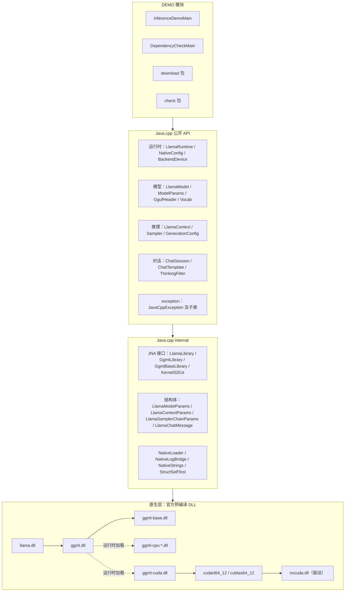
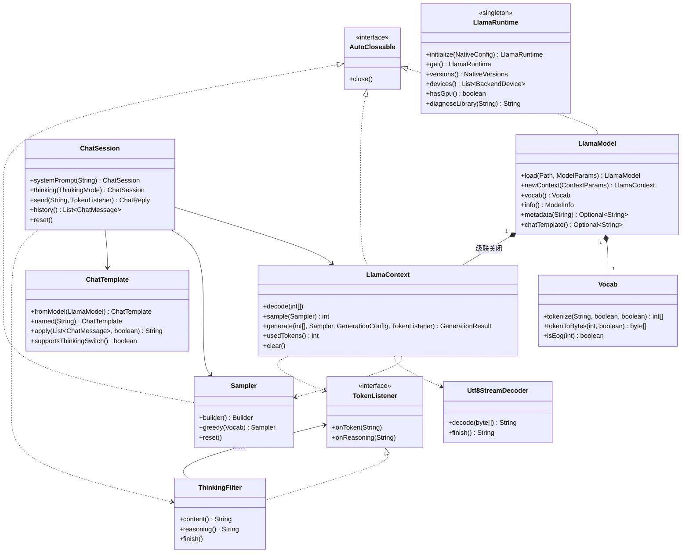
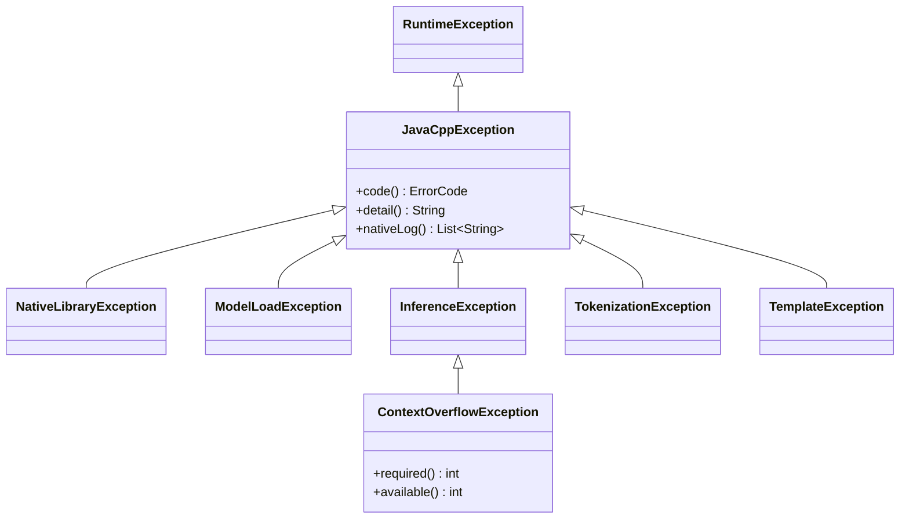
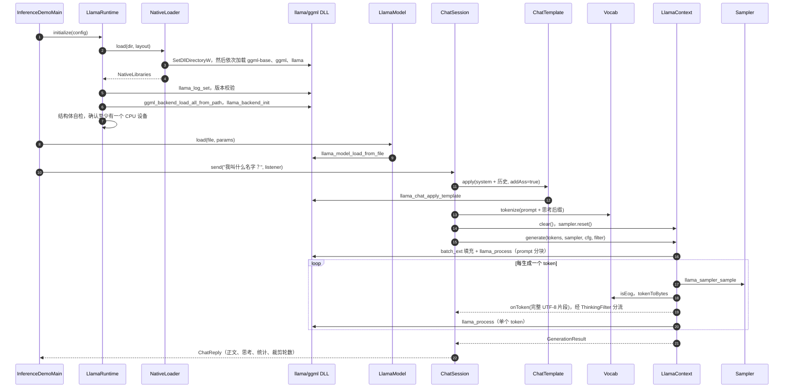

# Java.cpp 任务文档

> 2026-10-22 实施补充：当前目录状态、最小 demo 里程碑、开发顺序和需要细化的实现约定见 [WORK_PLAN.md](WORK_PLAN.md)。本地上游参考目录使用已有的 `llama.cpp/`。本文所列 ABI 数值、文件哈希和运行结果在本项目完成验证后再记录为已确认；完整课程范围继续采用 M1–M11。

> 课程：面向对象程序设计 ｜ 主题：用 Java 面向对象地“套壳” llama.cpp
> 交付：Java.cpp（类库模块）+ DEMO（演示模块） ｜ 平台：Windows 11 x64 + NVIDIA 显卡 ｜ JDK 21 + JNA
> 说明：本文档只规定**做什么、怎么组织、每个方法的签名和步骤**，不包含实现代码。文中的伪代码只写签名和步骤，不写方法体。

**目录**：0 一页看懂 · 1 范围 · 2 开发工具与环境 · 3 外部依赖准备 · 4 项目结构 · 5 架构 · 6 原生绑定层 · 7 公开 API 方法规划 · 8 编码规范 · 9 校验与异常 · 10 DEMO 规格 · 11 测试与验收 · 12 路线图 · 13 常见问题排查 · 14 OOP 要点与报告结构 · 15 许可证 · 16 参考资料

---

## 0 一页看懂

### 0.1 做什么

- **Java.cpp**：Java 21 类库。用 JNA 直接调用 llama.cpp 官方预编译 DLL 导出的 C API（`llama.h`），对外提供纯 Java 的面向对象 API：`LlamaRuntime → LlamaModel → LlamaContext / Sampler → ChatSession`。使用者看不到任何 `Pointer` 或 `Structure`。
- **DEMO**：只依赖 Java.cpp 公开 API 的演示模块，包含两个程序：
  1. `DependencyCheckMain`：依赖项校验与错误检测（C01–C14），并输出 `check-report.txt`；
  2. `InferenceDemoMain`：下载 Qwen3.5-0.8B 的 GGUF 权重（多源、断点续传、SHA-256 校验），演示流式多轮中文对话。
- **不需要** Python，**不编译**任何 C/C++，也不用装 Visual Studio、CUDA Toolkit 或 CMake。

### 0.2 调用链

```
DEMO：InferenceDemoMain / DependencyCheckMain
   │  只调用公开 API
   ▼
Java.cpp 公开 API（io.github.yaulun.javacpp、…exception）
   │
   ▼
Java.cpp internal（JNA 接口、Structure、NativeLoader、NativeLogBridge）
   │  JNA（libffi）
   ▼
llama.dll → ggml.dll → ggml-base.dll
                 │ ggml_backend_load_all_from_path 运行时加载
                 ├─► ggml-cpu-*.dll（按 CPU 指令集选一个）
                 └─► ggml-cuda.dll → cudart64_12 / cublas64_12 / cublasLt64_12 → nvcuda.dll（显卡驱动）
```

### 0.3 关键决定

| 问题 | 决定 | 理由 |
|---|---|---|
| 怎么调用 C 库 | JNA 5.19.1，接口映射 | 不写 C/C++、不用编译；JDK 21 中 FFM API 仍是预览特性，JDK 22 才正式发布（JEP 454） |
| 原生库从哪来 | llama.cpp 官方 release **b11669** 的 Windows CUDA 12.4 预编译包 | 官方构建，免编译，自带 CPU 后端兜底 |
| 版本策略 | 锁定 b11669；启动时校验 commit，并做结构体自检 | `llama.h` 不保证 ABI 稳定，结构体字段经常变化 |
| JDK | Eclipse Temurin 21（LTS，x64） | 可以使用 record、sealed、switch 模式匹配 |
| IDE / 构建 | IntelliJ IDEA + Maven 多模块 | 课程常用，资料多 |
| 演示模型 | Qwen3.5-0.8B，unsloth 的 GGUF：Q8_0（默认）/ Q4_K_M | 体积小（约 774 MiB），Apache-2.0 许可，中文能力好 |
| 对话模板 | 调用 `llama_chat_apply_template`（识别内置模板），Java 侧追加思考后缀 | 不需要实现 Jinja 引擎 |
| 生成策略 | v1 每轮清空 KV，重新输入完整 prompt | 简单可靠；增量复用放到选做 S1 |
| 模型分发 | 不放进仓库；DEMO 运行时下载（ModelScope → hf-mirror → HuggingFace） | 仓库体积小，国内网络可用 |

### 0.4 版本锁定

| 组件 | 锁定值 | 校验方式 |
|---|---|---|
| llama.cpp | **b11669**（即 v0.7.0，commit `620d2225c`，2026-10-15） | `ggml_commit()` 以 `620d2225c` 开头 |
| `llama_version()` | `0.7.0-dev` | 以 `0.7.0` 开头 |
| `ggml_version()` | `0.27.0` | 仅显示 |
| 原生包 | `llama-b11669-bin-win-cuda-12.4-x64.zip` + `cudart-llama-bin-win-cuda-12.4-x64.zip` | SHA-256（见 3.2） |
| JDK | Temurin 21 x64（写作时 Windows 版最新为 21.0.12） | C02 |
| Maven | 3.9.16（也可以用 IntelliJ 内置的 Maven） | `mvn -v` |
| JNA | 5.19.1 | C04 |
| JUnit | 6.1.3（通过 junit-bom 引入） | — |
| 模型 | unsloth/Qwen3.5-0.8B-GGUF，Q8_0 | 文件大小 + SHA-256（C10） |
| NVIDIA 驱动 | ≥ 551.61（CUDA 12.4 正式版在 Windows 上的要求） | C09 |
| VC++ 运行库 | 2015–2022 x64，≥ 14.40 | C05 |

### 0.5 命名约定

| 项 | 取值 |
|---|---|
| 工作区根目录 `<ROOT>` | 建议 `D:\dev\JavaCppWorkspace`（纯英文路径，不含空格） |
| 类库模块 | 目录 `Java.cpp`，artifactId `java-cpp`，包名 `io.github.yaulun.javacpp` |
| 演示模块 | 目录 `DEMO`，artifactId `demo`，包名 `io.github.yaulun.javacpp.demo` |
| 父 POM | groupId `io.github.yaulun`，artifactId `javacpp-parent`，version `1.0.0-SNAPSHOT` |
| 系统属性 / 环境变量 | `javacpp.natives` / `JAVACPP_NATIVES`，`javacpp.models` / `JAVACPP_MODELS` |

- 包名**不能以 `java.` 开头**：JVM 禁止应用类加载器定义 `java.*` 包，否则会抛 `SecurityException`。
- 注意与 bytedeco 的 **JavaCPP**（一个通用 JNI 生成器）区分：报告中要写明“Java.cpp（本项目）与 bytedeco/JavaCPP 无关”。

---

## 1 范围

### 1.1 必做（M1–M11）

| 编号 | 功能 | 验收要点 |
|---|---|---|
| M1 | 原生库加载、版本锁、结构体自检 | 目录错误报 E102/E103；版本不符报 E106；结构体大小为 80/168/1/16 |
| M2 | 后端与设备枚举 | 能列出 CPU 和 CUDA0（含显存）；`hasGpu()` 正确 |
| M3 | 日志桥 | 原生日志按行转发给 Java 监听器；出错时异常附带最近的原生日志 |
| M4 | 模型加载、元数据、关闭 | 显示 qwen35 / 24 层 / 262144 / 248320；支持进度回调和取消 |
| M5 | 词表：分词、反分词、UTF-8 流式解码 | 中文和 emoji 往返一致；流式输出不出现半个字 |
| M6 | 上下文与生成循环 | 流式输出；四种停止原因都能复现 |
| M7 | 采样器链 | 贪心可复现；同一种子可复现 |
| M8 | 对话模板与思考开关 | chatml 渲染正确；思考 on/off 生效；历史裁剪 |
| M9 | 异常体系 | 错误码 + 修复建议 + 原生日志 |
| M10 | DEMO：检查程序 + 推理程序 + 两个 cmd 脚本 | C01–C14；固定四轮对话脚本 |
| M11 | 测试 | 单元测试不依赖 DLL；集成测试满足条件时才运行；完成故障注入 |

### 1.2 选做（S1–S6）

| 编号 | 内容 | 要点 |
|---|---|---|
| S1 | 增量 KV 复用 | 记录上一轮输入的 token，找出与新 prompt 的公共前缀，调用 `llama_memory_seq_rm(mem, 0, 前缀长度, -1)` 后只输入后缀。Qwen3.5 是混合（循环层）架构，部分删除可能返回 false，此时要退回整段清空 |
| S2 | 文本嵌入 | 上下文开启 embeddings；用到的函数选做时再查 `llama.h` |
| S3 | 中止回调 | 给 `context_params.abort_callback` 传入 JNA 回调；长 prompt 处理可中断，`llama_process` 返回 2 时映射为 E304 |
| S4 | Vulkan 后端 | 改用官方 Vulkan 包（32.2 MB），用于 AMD/Intel 显卡；代码不变，只换 natives 目录 |
| S5 | JNA 直接映射对比 | 用 `Native.register` 直接映射重写热点函数，与接口映射比较 tok/s |
| S6 | 迷你 HTTP 服务 | 用 JDK 自带的 `HttpServer` 实现 `POST /v1/chat/completions`（兼容 OpenAI 格式，支持 SSE 流式），参考 FastAPI 的设计 |

### 1.3 不做

编译 llama.cpp；JNI / C++ 胶水代码；训练、微调、量化；多模态；GBNF 语法约束；Jinja 模板引擎；32 位系统和 macOS（Linux x64 只在枚举里预留，不验收）。

### 1.4 相关工作对比（报告中要写）

| 项目 | kherud/java-llama.cpp | Java.cpp（本项目） |
|---|---|---|
| 绑定方式 | JNI + 自写 C++ 胶水（复用 llama.cpp 的 server 代码） | JNA 直接映射 `llama.h` 的 C API，零 C++ |
| 构建 | 需要用 CMake 编译原生部分 | 不编译，使用官方预编译 DLL |
| llama.cpp 版本 | b4916（2025-03） | b11669（v0.7.0） |
| 最近发布 | 4.2.0 预发布版（2025-06-20），约 438 星 | — |
| GPU | 需要自己编译 CUDA 版 | 直接使用官方 CUDA 12.4 包 |
| Qwen3.5（qwen35 架构） | 版本较旧，预计不支持（未实测） | 支持 |
| 许可证 | MIT | MIT（建议） |
| 定位 | 功能完整的通用绑定 | 教学用：重点展示 OOP 封装、资源管理和错误诊断 |

其他可以提到的：bytedeco/javacpp-presets（JNI 生成器）、DJL（深度学习框架层）、whisper.cpp 官方 Java 绑定（同样基于 JNA，结构上最接近本项目）。

---

## 2 开发工具与环境

### 2.1 IDE 与构建工具

IntelliJ IDEA 是 **IDE**（写代码、调试、运行）；Maven / Gradle 是**构建工具**（管理依赖、编译、测试、打包）。两者不是二选一：用 IntelliJ 打开 Maven 项目即可。

| 选项 | 类型 | 优点 | 缺点 | 结论 |
|---|---|---|---|---|
| IntelliJ IDEA | IDE | Java 支持最好，内置 Maven，调试器好用 | 占内存较多 | ✅ 选用（免费版即可；学生可申请教育许可） |
| Eclipse | IDE | 免费、老牌 | 配置繁琐 | 备选 |
| VS Code + Java 扩展 | 编辑器 | 轻量 | 重构和调试较弱 | 不推荐 |
| Maven | 构建 | 约定优于配置，声明式，多模块结构清晰，资料多 | XML 冗长 | ✅ 选用 |
| Gradle | 构建 | 灵活、快 | 要学 DSL，插件版本兼容问题多 | 不选 |

可选：用 `mvn wrapper:wrapper` 生成 Maven Wrapper（`mvnw.cmd`），这样评阅者不装 Maven 也能构建。

### 2.2 需要安装的软件

| 软件 | 版本 | 来源 | 安装要点 | 验证 |
|---|---|---|---|---|
| Temurin JDK 21 x64 | 21.0.x | adoptium.net | 用 `.msi` 安装，勾选 “Set JAVA_HOME” 和 “Add to PATH” | `java -version` 显示 21 和 64-Bit |
| IntelliJ IDEA | 最新版 | jetbrains.com | 自带 Maven，可以不另外安装 | 能打开父 POM |
| Maven（可选） | 3.9.16 | maven.apache.org | 解压后把 `bin` 加入 PATH | `mvn -v` |
| Git | 最新版 | git-scm.com | 默认选项即可 | `git --version` |
| NVIDIA 驱动 | ≥ 551.61 | nvidia.com | Game Ready 或 Studio 驱动均可 | `nvidia-smi` |
| VC++ 2015–2022 x64 运行库 | ≥ 14.40 | https://aka.ms/vs/17/release/vc_redist.x64.exe | 已装旧版也要更新 | C05 |

**不需要**：Visual Studio、CUDA Toolkit、CMake、Python/Conda。

### 2.3 Maven 依赖与插件

| 坐标 | 版本 | 用在哪里 | 作用 |
|---|---|---|---|
| `net.java.dev.jna:jna` | 5.19.1 | Java.cpp（compile）、DEMO | 调用 DLL；不需要 jna-platform（kernel32 函数自己声明） |
| `org.junit:junit-bom` | 6.1.3 | 父 POM 的 dependencyManagement（import） | 统一 JUnit 版本 |
| `org.junit.jupiter:junit-jupiter` | 由 BOM 管理 | 两个模块（test） | 单元测试和集成测试 |
| maven-compiler-plugin | 3.16.0 | 父 POM | `release=21` |
| maven-surefire-plugin | 3.5.6 | 父 POM | 运行测试；默认排除 tag `native` |
| maven-resources-plugin | 3.5.0 | Java.cpp | 资源过滤，生成 `build.properties` |
| maven-jar-plugin | 3.5.1 | 两个模块 | 打 jar |
| maven-shade-plugin | 3.6.2 | DEMO | 打胖 jar `DEMO/target/demo-all.jar`，主类为 `InferenceDemoMain` |
| maven-enforcer-plugin | 3.6.3 | 父 POM | `requireJavaVersion [21,)`、`requireMavenVersion [3.9,)` |
| maven-clean-plugin / maven-install-plugin | 3.5.0 / 3.2.0 | 父 POM | 固定版本，避免构建警告 |

### 2.4 POM 清单（只列内容，不给完整 XML）

- **父 POM**：`packaging=pom`；`modules` 为 `Java.cpp`、`DEMO`（目录名可以带点）；properties 包括 `maven.compiler.release=21`、`project.build.sourceEncoding=UTF-8`、`jna.version=5.19.1`、`junit.version=6.1.3`、`llama.cpp.build=b11669`、`llama.cpp.version=0.7.0`、`llama.cpp.commit=620d2225c`；dependencyManagement 包括 jna、junit-bom（import）、java-cpp（`${project.version}`）；pluginManagement 固定上表中所有插件版本；enforcer 在父 POM 中生效。
- **Java.cpp/pom.xml**：依赖 jna、junit-jupiter（test）；只对 `build.properties` 开启资源过滤（内容：`javacpp.version=${project.version}`、`llama.build=${llama.cpp.build}`、`llama.version=${llama.cpp.version}`、`llama.commit=${llama.cpp.commit}`，只写 ASCII）。
- **DEMO/pom.xml**：依赖 java-cpp、jna、junit-jupiter（test）；shade 插件配置 `finalName=demo-all`，并用 `ManifestResourceTransformer` 设置主类。`DependencyCheckMain` 通过 `-cp` 启动。

### 2.5 Maven 国内镜像

在 `%USERPROFILE%\.m2\settings.xml` 中加入镜像（id=`aliyun`，mirrorOf=`central`）：

```xml
<settings>
  <mirrors>
    <mirror>
      <id>aliyun</id>
      <mirrorOf>central</mirrorOf>
      <url>https://maven.aliyun.com/repository/public</url>
    </mirror>
  </mirrors>
</settings>
```

### 2.6 IntelliJ 设置

- File → Project Structure → SDK 选 Temurin 21；Language level 选 21。
- Settings → Editor → File Encodings：全部设为 UTF-8；Settings → Editor → General → Console：默认编码设为 UTF-8。
- 运行配置：Working directory 设为 `<ROOT>`；VM options 设为 `-Dstdout.encoding=UTF-8 -Dstderr.encoding=UTF-8`（需要时再加 `-Djavacpp.natives=...`）。

---

## 3 外部依赖准备

### 3.1 原则

- **不克隆、不编译** llama.cpp，只下载两个官方 zip。
- 两个 zip **解压到同一个目录** `<ROOT>\natives\llama-b11669-win-cuda-12.4-x64\`，**不要多套一层**：`llama.dll` 必须直接位于这个目录下（资源管理器的“全部解压缩”默认会再建一层同名文件夹，要去掉）。
- 先用官方 `llama-cli.exe` 自检，确认 DLL、驱动、模型都没问题，再写 Java。

### 3.2 原生库包选择（发布页：`https://github.com/ggml-org/llama.cpp/releases/tag/b11669`）

| 包 | 大小 | SHA-256 | 结论 |
|---|---|---|---|
| `llama-b11669-bin-win-cuda-12.4-x64.zip` | 266.6 MB | `c2da1f73ed176ae093ac5aceb978a7b167a16113f6d74c6789eeaee2135cb8dc` | ✅ 主包 |
| `cudart-llama-bin-win-cuda-12.4-x64.zip` | 391.4 MB | `8c79a9b226de4b3cacfd1f83d24f962d0773be79f1e7b75c6af4ded7e32ae1d6` | ✅ CUDA 运行库（cudart64_12、cublas64_12、cublasLt64_12） |
| CUDA 13.4 两个包 | 154.6 + 423.5 MB | — | ❌ 需要更新的驱动，且不支持 Turing 之前的显卡 |
| Vulkan 包 | 32.2 MB | — | 选做 S4 |
| CPU 包 | 19.5 MB | — | 没有 NVIDIA 显卡时使用 |

注意：v0.7.0 的 release 页只有 `nightly-tag.txt`，二进制文件在 **b11669** 的 release 页上。

解压后应能看到：`llama.dll`、`ggml.dll`、`ggml-base.dll`、`libomp.dll`、`ggml-cuda.dll`（约 575 MB）、14 个 `ggml-cpu-*.dll`、`ggml-rpc.dll`、`llama-cli.exe` 等，以及 `cudart64_12.dll`、`cublas64_12.dll`、`cublasLt64_12.dll`。

### 3.3 下载、校验、解压、自检（PowerShell）

```powershell
cd D:\dev\JavaCppWorkspace
mkdir downloads, models, natives\llama-b11669-win-cuda-12.4-x64
# 用浏览器把两个 zip 下载到 downloads\，地址为：
#   https://github.com/ggml-org/llama.cpp/releases/download/b11669/llama-b11669-bin-win-cuda-12.4-x64.zip
#   https://github.com/ggml-org/llama.cpp/releases/download/b11669/cudart-llama-bin-win-cuda-12.4-x64.zip
Get-FileHash downloads\llama-b11669-bin-win-cuda-12.4-x64.zip -Algorithm SHA256
Get-FileHash downloads\cudart-llama-bin-win-cuda-12.4-x64.zip -Algorithm SHA256
Expand-Archive downloads\llama-b11669-bin-win-cuda-12.4-x64.zip -DestinationPath natives\llama-b11669-win-cuda-12.4-x64
Expand-Archive downloads\cudart-llama-bin-win-cuda-12.4-x64.zip -DestinationPath natives\llama-b11669-win-cuda-12.4-x64 -Force
cd natives\llama-b11669-win-cuda-12.4-x64
.\llama-cli.exe --list-devices        # 应能看到 CUDA0
```

### 3.4 头文件（只用来对照，不参与构建）

二选一：

- 稀疏浅克隆：
  ```powershell
  git clone --depth 1 --branch b11669 --filter=blob:none --sparse https://github.com/ggml-org/llama.cpp.git third_party/llama.cpp
  cd third_party/llama.cpp
  git sparse-checkout set include ggml/include examples/simple-chat
  ```
- 或者直接下载这几个原始文件：`include/llama.h`、`ggml/include/ggml.h`、`ggml/include/ggml-backend.h`、`examples/simple-chat/simple-chat.cpp`（`https://raw.githubusercontent.com/ggml-org/llama.cpp/b11669/<路径>`）。

`simple-chat.cpp` 是官方最小对话示例，Java.cpp 的生成循环就是照着它的调用顺序来写的。

### 3.5 模型

| 量化 | 文件名 | 字节数 | SHA-256 | 说明 |
|---|---|---|---|---|
| Q8_0（默认） | `Qwen3.5-0.8B-Q8_0.gguf` | 811,843,840（约 774 MiB） | `0ad885ffd4bb022fc4f0d33a3308fa108ef8613159d3b3a67e23abca056b7a6c` | 质量接近原始权重 |
| Q4_K_M | `Qwen3.5-0.8B-Q4_K_M.gguf` | 532,517,120（约 508 MiB） | `bd258782e35f7f458f8aced1adc053e6e92e89bc735ba3be89d38a06121dc517` | 更小、更快 |

三个下载源（文件完全相同，都支持 Range 断点续传）：

| 源 | URL 模板（把 `<文件名>` 替换掉） |
|---|---|
| ModelScope | `https://www.modelscope.cn/models/unsloth/Qwen3.5-0.8B-GGUF/resolve/88467eb7c8e3b6e7894c794f373050d4dbc6ae8a/<文件名>` |
| hf-mirror | `https://hf-mirror.com/unsloth/Qwen3.5-0.8B-GGUF/resolve/6ab461498e2023f6e3c1baea90a8f0fe38ab64d0/<文件名>` |
| HuggingFace | `https://huggingface.co/unsloth/Qwen3.5-0.8B-GGUF/resolve/6ab461498e2023f6e3c1baea90a8f0fe38ab64d0/<文件名>` |

阶段 2 还没有 DEMO 下载器时，可以先手动下载（Windows 11 自带 `curl.exe`，`-L` 跟随重定向，`-C -` 断点续传）：
`curl.exe -L -C - -o models\Qwen3.5-0.8B-Q8_0.gguf <ModelScope URL>`，下载后用 `Get-FileHash` 核对。

模型自检：
`.\llama-cli.exe -m ..\..\models\Qwen3.5-0.8B-Q8_0.gguf -ngl 99 -st -rea off -p "Hello, introduce yourself in one sentence."`

### 3.6 不放进 Git 的内容（.gitignore）

`natives/*`、`models/*`、`downloads/`、`third_party/llama.cpp/`、`target/`、`.idea/`、`*.iml`、`check-report.txt`、`*.part`、`hs_err_pid*.log`（`natives/`、`models/` 下可以各放一个 `README.md` 说明该放什么）。

---

## 4 项目结构

```
<ROOT>（D:\dev\JavaCppWorkspace）
├─ pom.xml                         父 POM：模块列表、统一版本、插件管理
├─ .gitignore
├─ README.md                       快速开始：环境 → 下载 → 运行
├─ THIRD-PARTY.md                  第三方许可证声明
├─ run-check.cmd                   启动依赖校验程序（ASCII + CRLF）
├─ run-demo.cmd                    启动推理演示（ASCII + CRLF）
├─ docs/report.md                  课程报告
├─ natives/llama-b11669-win-cuda-12.4-x64/   两个 zip 解压到这里（不入 Git）
├─ models/                         GGUF 模型（不入 Git）
├─ downloads/                      原始 zip（不入 Git）
├─ third_party/llama.cpp/          头文件，仅供对照（不入 Git）
├─ Java.cpp/
│  ├─ pom.xml                      artifactId java-cpp
│  └─ src/
│     ├─ main/java/io/github/yaulun/javacpp/
│     │  ├─ JavaCpp.java               读取 build.properties：版本号与 banner
│     │  ├─ LlamaRuntime.java          单例：加载 DLL、版本校验、后端初始化、设备查询、诊断
│     │  ├─ NativeConfig.java          运行时配置（natives 目录、日志级别、监听器）+ Builder
│     │  ├─ NativeLayout.java          枚举：各平台的 DLL 文件名规则与目录检查
│     │  ├─ NativeVersions.java        record：llama / ggml / commit 版本
│     │  ├─ BackendDevice.java         record：一个计算设备（名称、类型、显存）
│     │  ├─ DeviceType.java            枚举：CPU / GPU / IGPU / ACCEL / META / UNKNOWN
│     │  ├─ LogLevel.java              枚举：DEBUG / INFO / WARN / ERROR
│     │  ├─ NativeLogListener.java     函数式接口：接收原生日志行
│     │  ├─ GgufHeader.java            record：读取并校验 GGUF 文件头
│     │  ├─ ModelParams.java           模型加载参数 + Builder
│     │  ├─ LoadProgressListener.java  函数式接口：加载进度，返回 false 表示取消
│     │  ├─ ModelInfo.java             record：模型摘要信息
│     │  ├─ LlamaModel.java            模型对象：加载、元数据、模板、创建上下文、级联关闭
│     │  ├─ Vocab.java                 词表：分词、反分词、特殊 token
│     │  ├─ Utf8StreamDecoder.java     把逐 token 的字节流拼成完整 UTF-8 字符
│     │  ├─ ContextParams.java         上下文参数 + Builder
│     │  ├─ FlashAttention.java        枚举：AUTO / DISABLED / ENABLED
│     │  ├─ LlamaContext.java          推理上下文：decode、sample、generate、并发保护
│     │  ├─ GenerationConfig.java      record：最大 token 数、取消条件
│     │  ├─ GenerationResult.java      record：文本、token 数、速度、停止原因
│     │  ├─ StopReason.java            枚举：四种停止原因
│     │  ├─ TokenListener.java         函数式接口：流式输出回调
│     │  ├─ Sampler.java               采样器链 + Builder
│     │  ├─ Role.java                  枚举：SYSTEM / USER / ASSISTANT
│     │  ├─ ChatMessage.java           record：一条对话消息
│     │  ├─ ThinkingMode.java          枚举：OFF / ON
│     │  ├─ ChatReply.java             record：一轮回复（正文、思考、统计、裁剪轮数）
│     │  ├─ ChatTemplate.java          对话模板渲染
│     │  ├─ ChatSession.java           多轮对话外观类：历史、裁剪、思考开关、回滚
│     │  ├─ ThinkingFilter.java        （包内可见）把 <think> 内容与正文分开的状态机
│     │  ├─ exception/
│     │  │  ├─ ErrorCode.java              枚举：错误码 + 标题 + 修复建议
│     │  │  ├─ JavaCppException.java       sealed 基类：code / detail / nativeLog
│     │  │  ├─ NativeLibraryException.java E1xx
│     │  │  ├─ ModelLoadException.java     E2xx
│     │  │  ├─ InferenceException.java     E301 / E303 / E304 / E501
│     │  │  ├─ ContextOverflowException.java  E302，带 required / available
│     │  │  ├─ TokenizationException.java  E401
│     │  │  └─ TemplateException.java      E402 / E403
│     │  └─ internal/                  （不对外；DEMO 禁止使用）
│     │     ├─ NativeStrings.java          Java 字符串 ↔ C 字符串（UTF-8）
│     │     ├─ LlamaLibrary.java           llama.dll 的 JNA 接口（含回调接口）
│     │     ├─ GgmlLibrary.java            ggml.dll 的 JNA 接口（后端注册、设备枚举）
│     │     ├─ GgmlBaseLibrary.java        ggml-base.dll 的 JNA 接口（版本、设备属性）
│     │     ├─ Kernel32Ext.java            SetDllDirectoryW、LoadLibraryExW、FreeLibrary
│     │     ├─ LlamaModelParams.java       Structure：llama_model_params（80 字节）
│     │     ├─ LlamaContextParams.java     Structure：llama_context_params（168 字节）
│     │     ├─ LlamaSamplerChainParams.java Structure：llama_sampler_chain_params（1 字节）
│     │     ├─ LlamaChatMessage.java       Structure：llama_chat_message（16 字节）
│     │     ├─ StructSelfTest.java         结构体大小、偏移、默认值自检
│     │     ├─ NativeLibraries.java        record：已加载的三个库 + 目录 + 平台
│     │     ├─ NativeLoader.java           按顺序加载 DLL、核对导出函数、诊断加载错误
│     │     ├─ ProbeResult.java            record：单个 DLL 的试加载结果
│     │     └─ NativeLogBridge.java        单例日志回调：按行拼接、转发、缓存最近问题
│     ├─ main/resources/io/github/yaulun/javacpp/build.properties   资源过滤生成
│     └─ test/java/io/github/yaulun/javacpp/   单元测试（*Test）与集成测试（*IT，tag native）
└─ DEMO/
   ├─ pom.xml                      artifactId demo；shade 生成 target/demo-all.jar
   └─ src/
      ├─ main/java/io/github/yaulun/javacpp/demo/
      │  ├─ InferenceDemoMain.java     推理演示入口
      │  ├─ DependencyCheckMain.java   依赖校验入口
      │  ├─ CliArgs.java               通用命令行解析（未知参数 → 退出码 2）
      │  ├─ DemoPaths.java             定位 <ROOT>、natives、models、报告文件
      │  ├─ ConsoleSupport.java        控制台 UTF-8（自行用 JNA 调用 kernel32）
      │  ├─ SamplingPresets.java       Qwen 推荐采样参数、贪心
      │  ├─ download/
      │  │  ├─ ModelSpec.java              record：量化名、文件名、大小、SHA-256
      │  │  ├─ ModelCatalog.java           Q8_0（默认）/ Q4_K_M
      │  │  ├─ DownloadSource.java         枚举：MODELSCOPE / HF_MIRROR / HUGGINGFACE
      │  │  ├─ ModelDownloader.java        多源、续传、进度、校验、原子改名
      │  │  └─ DownloadException.java      下载失败（汇总各源原因）
      │  └─ check/
      │     ├─ Check.java                  接口：id、title、dependsOn、run
      │     ├─ CheckStatus.java            枚举：PASS / WARN / FAIL / SKIP
      │     ├─ CheckResult.java            record：状态、摘要、详情、修复建议、耗时
      │     ├─ CheckContext.java           检查间共享的上下文（路径、选项、运行时、模型）
      │     ├─ CheckRunner.java            按依赖顺序执行检查，前置失败则 SKIP
      │     ├─ CheckReport.java            控制台输出 + 写 check-report.txt + 退出码
      │     ├─ PeVersionReader.java        读取 DLL 文件版本号（VS_FIXEDFILEINFO）
      │     ├─ EnvironmentChecks.java      C01–C05、C11、C12
      │     ├─ NativeChecks.java           C06–C09
      │     ├─ ModelChecks.java            C10
      │     └─ RuntimeChecks.java          C13、C14
      └─ test/java/io/github/yaulun/javacpp/demo/   CliArgs、下载器（本地 HttpServer 模拟）、PeVersionReader 等测试
```

### 4.1 依赖规则

| 规则 | 检查方式 |
|---|---|
| DEMO 只能使用 Java.cpp 的公开 API，**禁止** import `io.github.yaulun.javacpp.internal` | DEMO 里写一个测试，扫描自己的源码，发现该 import 就失败 |
| 公开 API 的签名中不出现 `Pointer`、`Structure`、`Memory` 等 JNA 类型 | 代码评审 + 一个反射测试：遍历公开类的 public 方法签名 |
| exception 包不依赖 internal（原生日志由抛出点传入） | 代码评审 |
| internal 不依赖公开 API 中的高层类（如 ChatSession） | 代码评审 |
| 唯一例外：DEMO 的 `ConsoleSupport` 自己声明一个最小 JNA 接口来调用 kernel32 的控制台函数（不属于 Java.cpp internal） | — |

不使用 JPMS（module-info）：JNA 需要反射访问 internal 中的接口和结构体，而且 shade 打包后模块信息会失效。选做时可以加 module-info，只导出公开包，并对 JNA `opens` internal 包。

---

## 5 架构

### 5.1 分层图



### 5.2 类图（核心）



异常层次：



### 5.3 时序图：初始化 + 一轮对话



### 5.4 资源所有权

| 原生资源 | 创建 | 释放 | 持有者 | 规则 |
|---|---|---|---|---|
| DLL 句柄 | NativeLoader | 不释放（进程结束） | LlamaRuntime | 不提供 shutdown，卸载 DLL 不安全 |
| `llama_model*` | `llama_model_load_from_file` | `llama_model_free` | LlamaModel | close 时先关闭它的所有上下文 |
| `llama_vocab*` | `llama_model_get_vocab` | 不释放（归模型所有） | Vocab | 模型关闭后 Vocab 不可用 |
| `llama_context*` + `llama_batch_ext*` | `llama_init_from_model` / `llama_batch_ext_init` | `llama_batch_ext_free` → `llama_free` | LlamaContext | 先释放 batch，再释放 context |
| `llama_sampler*`（链） | `llama_sampler_chain_init` + `init_*` | `llama_sampler_free(链)` | Sampler | 子采样器加入链后归链所有，不能单独释放 |
| 模板字符串 | `llama_model_chat_template` | 不释放（归模型所有） | — | 立即复制成 Java String |
| 回调对象 | Java | GC | 静态字段 / 实例字段 | 必须强引用，原生侧还可能调用 |
| `Memory`（C 字符串、结构体数组） | Java | GC | 调用期间的局部变量 | 原生调用结束前不能被回收 |

---

## 6 原生绑定层（internal）

### 6.1 类型映射

| C 类型 | JNA 中的 Java 类型 | 说明 |
|---|---|---|
| `int32_t`、`llama_token`、`llama_pos`、`llama_seq_id`、各种 `enum` | `int` | |
| `uint32_t` | `int` | 无符号：按位传递，如种子 4294967295 传 `(int) 0xFFFFFFFFL`（即 -1） |
| `int64_t`、`uint64_t` | `long` | |
| `size_t` | `long` | 只支持 64 位；**不要用 `NativeLong`**（Windows 上 C 的 `long` 只有 32 位） |
| `float` | `float` | |
| `bool` | `byte` | MSVC 中占 1 字节；用 `NativeStrings.cBool` / `isTrue` 转换 |
| `const char *`（以 0 结尾的入参） | `String` | 加载时设置 `OPTION_STRING_ENCODING=UTF-8`；调用前确认不含 `'\0'` |
| `const char *`（另外传长度的入参，如 tokenize） | `byte[]` | 自己编码为 UTF-8，长度单独传 |
| `char *`（输出缓冲区） | `byte[]` | 按返回的字节数截取 |
| `const char *`（返回值） | `String` | 由原生侧持有，JNA 会复制一份 |
| `llama_token *` | `int[]` | |
| `size_t *`（输出参数） | `LongByReference` | |
| 不透明指针（`llama_model *` 等） | `Pointer` | 只出现在 internal 和包内可见的方法中 |
| 按值传递或返回的结构体 | `XxxParams.ByValue` | |
| 结构体数组 | `Structure[]`（必须用 `toArray` 生成，保证内存连续） | |
| 函数指针 | `Callback` 的子接口 | 必须保持强引用 |

### 6.2 函数清单（全部来自 b11669 头文件）

| DLL | C 函数 | JNA 映射（返回类型 名称(参数)） | 用于 |
|---|---|---|---|
| ggml-base | `ggml_version` / `ggml_commit` | `String ggml_version()` / `String ggml_commit()` | 版本校验 |
| ggml-base | `ggml_backend_dev_name` / `ggml_backend_dev_description` | `String …(Pointer dev)` | 设备信息 |
| ggml-base | `ggml_backend_dev_type` | `int ggml_backend_dev_type(Pointer dev)` | 0=CPU 1=GPU 2=IGPU 3=ACCEL 4=META |
| ggml-base | `ggml_backend_dev_memory` | `void …(Pointer dev, LongByReference free, LongByReference total)` | 显存 |
| ggml | `ggml_backend_load_all_from_path` | `void …(String dirPath)` | 加载 CPU/CUDA 后端 |
| ggml | `ggml_backend_dev_count` / `ggml_backend_dev_get` | `long …()` / `Pointer …(long index)` | 枚举设备 |
| ggml | `ggml_backend_reg_count` | `long …()` | 诊断 |
| llama | `llama_log_set` | `void …(LogCallback cb, Pointer userData)` | 日志桥 |
| llama | `llama_backend_init` | `void …()` | 初始化 |
| llama | `llama_version` / `llama_print_system_info` | `String …()` | 版本、系统信息 |
| llama | `llama_supports_gpu_offload` | `byte …()` | GPU 能力 |
| llama | `llama_model_default_params` / `llama_context_default_params` / `llama_sampler_chain_default_params` | `XxxParams.ByValue …()` | 默认参数、自检 |
| llama | `llama_model_load_from_file` | `Pointer …(String path, LlamaModelParams.ByValue p)` | 加载模型 |
| llama | `llama_model_free` | `void …(Pointer model)` | 释放模型 |
| llama | `llama_model_get_vocab` | `Pointer …(Pointer model)` | 词表 |
| llama | `llama_model_n_layer` / `llama_model_n_ctx_train` / `llama_model_n_embd` | `int …(Pointer model)` | ModelInfo |
| llama | `llama_model_desc` | `int …(Pointer model, byte[] buf, long bufSize)` | 描述 |
| llama | `llama_model_size` / `llama_model_n_params` | `long …(Pointer model)` | 大小、参数量 |
| llama | `llama_model_is_recurrent` / `llama_model_is_hybrid` | `byte …(Pointer model)` | 架构特征 |
| llama | `llama_model_meta_val_str` | `int …(Pointer model, String key, byte[] buf, long bufSize)` | 按键读取元数据 |
| llama | `llama_model_meta_count` | `int …(Pointer model)` | 元数据个数 |
| llama | `llama_model_meta_key_by_index` / `llama_model_meta_val_str_by_index` | `int …(Pointer model, int i, byte[] buf, long bufSize)` | 遍历元数据 |
| llama | `llama_model_chat_template` | `String …(Pointer model, String name)`（name 传 null 表示默认模板） | 对话模板 |
| llama | `llama_vocab_n_tokens` / `llama_vocab_bos` / `llama_vocab_eos` | `int …(Pointer vocab)` | 词表信息 |
| llama | `llama_vocab_is_eog` | `byte …(Pointer vocab, int token)` | 判断生成结束 |
| llama | `llama_tokenize` | `int …(Pointer vocab, byte[] text, int textLen, int[] tokens, int nTokensMax, byte addSpecial, byte parseSpecial)` | 分词 |
| llama | `llama_token_to_piece` | `int …(Pointer vocab, int token, byte[] buf, int length, int lstrip, byte special)` | token → 字节 |
| llama | `llama_detokenize` | `int …(Pointer vocab, int[] tokens, int nTokens, byte[] text, int textLenMax, byte removeSpecial, byte unparseSpecial)` | 反分词 |
| llama | `llama_init_from_model` | `Pointer …(Pointer model, LlamaContextParams.ByValue p)` | 创建上下文 |
| llama | `llama_free` | `void …(Pointer ctx)` | 释放上下文 |
| llama | `llama_n_ctx` / `llama_n_batch` / `llama_n_ubatch` | `int …(Pointer ctx)` | 实际参数 |
| llama | `llama_get_memory` | `Pointer …(Pointer ctx)` | KV 内存句柄 |
| llama | `llama_memory_clear` | `void …(Pointer mem, byte data)` | 清空 |
| llama | `llama_memory_seq_pos_max` | `int …(Pointer mem, int seqId)` | 已用 token 数 |
| llama | `llama_memory_seq_rm` | `byte …(Pointer mem, int seqId, int p0, int p1)` | 选做 S1 |
| llama | `llama_batch_ext_init` / `llama_batch_ext_free` / `llama_batch_ext_clear` | `Pointer …(Pointer ctx)` / `void …(Pointer batch)` / `void …(Pointer batch)` | 批次 |
| llama | `llama_batch_ext_add_token` | `int …(Pointer batch, int seqId, int token)` | 加入 token，返回下标 |
| llama | `llama_batch_ext_set_pos` | `byte …(Pointer batch, int idx, int[] pos)` | 设置位置 |
| llama | `llama_batch_ext_set_output_logits` | `byte …(Pointer batch, int idx, byte value)` | 标记需要 logits |
| llama | `llama_process` | `int …(Pointer ctx, int type, Pointer batch)`（type：ENCODE=0，DECODE=1） | 推理 |
| llama | `llama_sampler_chain_init` / `llama_sampler_chain_add` | `Pointer …(LlamaSamplerChainParams.ByValue p)` / `void …(Pointer chain, Pointer smpl)` | 采样链 |
| llama | `llama_sampler_init_penalties` | `Pointer …(int nVocab, int lastN, float repeat, float freq, float present)` | 惩罚 |
| llama | `llama_sampler_init_top_k` / `top_p` / `min_p` / `temp` / `dist` / `greedy` | `(int k)` / `(float p, long minKeep)` / `(float p, long minKeep)` / `(float t)` / `(int seed)` / `()`，都返回 `Pointer` | 采样器 |
| llama | `llama_sampler_sample` | `int …(Pointer smpl, Pointer ctx, int idx)` | 采样 |
| llama | `llama_sampler_reset` / `llama_sampler_free` | `void …(Pointer smpl)` | 重置、释放 |
| llama | `llama_chat_apply_template` | `int …(String tmpl, LlamaChatMessage[] chat, long nMsg, byte addAss, byte[] buf, int length)` | 渲染模板 |
| kernel32 | `SetDllDirectoryW` / `LoadLibraryExW` / `FreeLibrary` | `boolean …(WString dir)` / `Pointer …(WString path, Pointer hFile, int flags)` / `boolean …(Pointer h)` | DLL 搜索目录、诊断 |

### 6.3 签名陷阱（逐条核对）

1. C 的 `bool` 映射为 `byte`，参数和返回值都一样，不要用 Java `boolean`。
2. `size_t` 映射为 `long`，**不能用 `NativeLong`**。
3. `llama_sampler_init_penalties` 有 **5 个参数，第一个是 `n_vocab`**（旧版本没有）；`last_n` 会被限制为 ≥ 0，所以 -1 **不**表示“整个上下文”。
4. `llama_tokenize` 的 `text_len` 是 **UTF-8 字节数**，不是 `String.length()`。
5. `llama_token_to_piece` **不写结尾的 0**，要按返回值截取。
6. `llama_chat_apply_template` 返回**所需的总长度**，可能比缓冲区大，此时要重新分配再调用一次；返回 -1 表示模板不受支持。
7. `llama_sampler_sample` 内部**已经调用了 accept**，不要再调 `llama_sampler_accept`，否则惩罚会算两次。
8. `llama_sampler_chain_add` 之后，子采样器**归链所有**，只能释放链；单独释放子采样器会导致重复释放而崩溃。
9. `llama_model_chat_template` 返回的字符串归模型所有，不能释放；模型关闭后失效，所以要立即复制。
10. `llama_batch_ext` 的容量等于 `n_batch`，超出时 `add_token` 返回 -1；`set_token_id` 会检查 `0 ≤ id < n_vocab`，越界返回 -2。所以要在 Java 侧先做 `checkToken`。
11. `llama_batch_ext_set_pos` 的第三个参数是 `const llama_pos *`（**指针**），文本 token 传长度为 1 的 `int[]`。
12. `llama_batch_get_one` 在头文件中注明 “avoid using it”，不要使用。
13. 回调对象（`LogCallback`、`ProgressCallback`）必须用静态字段或实例字段强引用，否则被 GC 回收后，原生侧再回调就会崩溃。
14. 回调里不能让异常抛回原生侧：`invoke` 内部要 `catch (Throwable)`。
15. `xxx_default_params()` 返回的是值，传给 `load_from_file` / `init_from_model` 时参数类型要声明为 `.ByValue`。
16. 加载库时一定要设置 `Library.OPTION_STRING_ENCODING = "UTF-8"`，否则 JNA 会使用 `native.encoding`（中文 Windows 上是 GBK），中文路径会乱码或找不到文件。
17. 不要给 kernel32 函数声明 `throws LastErrorException`（调用成功时也可能残留错误码，导致误报）。应检查返回值，失败时再用 `Native.getLastError()` 取错误码。
18. 不要自己 `new` 一个全 0 的参数结构体直接传入：全 0 和默认值不同（例如 `load_mode` 默认是 -1）。一定要从 `xxx_default_params()` 开始修改。

### 6.4 结构体映射

规则：

- `@FieldOrder` 中的字段顺序与 `llama.h` **完全一致**，一个都不能少，包括我们不用的字段。
- Java 字段名与 C 字段名相同（snake_case，是命名规范的例外），方便对照。
- 每个结构体都提供 `ByValue` 子类；另外提供 `static int offsetOf(String field)`（内部调用 protected 的 `fieldOffset`），供自检使用。
- 只修改需要的字段，其余保持 `default_params` 返回的值。
- 回调字段声明为 `Callback` 子接口，不用时为 null。

**llama_model_params**（80 字节，17 个字段；Java.cpp 只修改标 ★ 的字段）

| 偏移 | C 字段 | Java 类型 | | 偏移 | C 字段 | Java 类型 |
|---|---|---|---|---|---|---|
| 0 | `devices` | Pointer | | 48 | ★`progress_callback` | ProgressCallback |
| 8 | `tensor_buft_overrides` | Pointer | | 56 | `progress_callback_user_data` | Pointer |
| 16 | ★`n_gpu_layers` | int | | 64 | `kv_overrides` | Pointer |
| 20 | `split_mode` | int | | 72 | ★`vocab_only` | byte |
| 24 | `load_mode` | int | | 73 | `check_tensors` | byte |
| 28 | `lazy_mode` | int | | 74 | `use_extra_bufts` | byte |
| 32 | ★`main_gpu` | int | | 75 | `no_host` | byte |
| 40 | `tensor_split` | Pointer（36–39 为填充） | | 76–77 | `no_alloc`、`load_mtp` | byte（78–79 为填充） |

**llama_context_params**（168 字节，38 个字段；只修改 ★ 字段）

| 偏移 | 字段（按顺序） | Java 类型 |
|---|---|---|
| 0–35 | ★`n_ctx`、★`n_batch`、★`n_ubatch`、★`n_seq_max`、`n_rs_seq`、`n_outputs_max`、`n_outputs_max_per_seq`、★`n_threads`、★`n_threads_batch` | 9 × int |
| 36–55 | `ctx_type`、`rope_scaling_type`、`pooling_type`、`attention_type`、★`flash_attn_type` | 5 × int（enum） |
| 56–79 | `rope_freq_base`、`rope_freq_scale`、`yarn_ext_factor`、`yarn_attn_factor`、`yarn_beta_fast`、`yarn_beta_slow` | 6 × float |
| 80 / 84 | `yarn_orig_ctx` / `defrag_thold` | int / float |
| 88 / 96 | `cb_eval` / `cb_eval_user_data` | Pointer / Pointer |
| 104 / 108 | `type_k` / `type_v` | int / int |
| 112 | `moe_cache_size` | long（size_t） |
| 120 / 128 | `abort_callback`（选做 S3 时改成 Callback） / `abort_callback_data` | Pointer / Pointer |
| 136–141 | `embeddings`、`offload_kqv`、`no_perf`、`op_offload`、`swa_full`、`kv_unified` | 6 × byte（142–143 为填充） |
| 144 / 152 / 160 | `samplers` / `n_samplers` / `ctx_other` | Pointer / long / Pointer |

**llama_sampler_chain_params**（1 字节）：`no_perf`（byte）。**llama_chat_message**（16 字节）：`role`、`content`，都是 Pointer（指向 `NativeStrings.toNativeMemory` 分配的 UTF-8 内存）。

### 6.5 默认值自检（StructSelfTest；数值为 b11669 实测）

| 结构体 | 字段 = 期望默认值 |
|---|---|
| model_params | `n_gpu_layers=-1`、`split_mode=1`、`load_mode=-1`、`lazy_mode=1`、`vocab_only=0`、`check_tensors=0`、`use_extra_bufts=1` |
| context_params | `n_ctx=512`、`n_batch=2048`、`n_ubatch=512`、`n_seq_max=1`、`n_threads=4`、`flash_attn_type=-1`、`yarn_ext_factor=-1.0`、`type_k=1`、`type_v=1`、`offload_kqv=1`、`no_perf=1`、`op_offload=1`、`swa_full=1`、`kv_unified=0`、`samplers=NULL`、`n_samplers=0`、`ctx_other=NULL` |
| sampler_chain_params | `no_perf=1` |
| 大小 / 偏移 | 80 / 168 / 1 / 16；`progress_callback=48`、`vocab_only=72`、`flash_attn_type=52`、`type_k=104`、`embeddings=136`、`samplers=144`、`ctx_other=160` |

任何一项不符，都说明字段映射错了或 DLL 版本不对，报 **E106**，并列出所有不符的项。

### 6.6 Windows DLL 加载要点

1. 用**绝对路径**加载。JNA 内部使用 `LoadLibraryExW` + `LOAD_WITH_ALTERED_SEARCH_PATH`，会在该 DLL 所在目录查找依赖，所以 ggml-base、libomp、ggml 都能找到。
2. 但 ggml 在 `load_all_from_path` 中用普通的 `LoadLibraryW` 加载 `ggml-cuda.dll` 和 `ggml-cpu-*.dll`，**不会**在它们所在目录查找依赖（cudart64_12、cublas64_12、libomp）。所以**必须先调用 `SetDllDirectoryW(dir)`**。
3. release 版的 `load_all` **静默失败**：加载失败时只会退回 CPU，没有任何报错。因此需要 C08 检查和 `diagnoseLibrary` 来诊断。
4. 调用顺序固定：`llama_log_set` → `ggml_backend_load_all_from_path` → `llama_backend_init`，而且整个进程只能执行一次（重复执行会重复注册设备）。
5. VC++ 运行库：JDK 的 `bin` 目录自带 `vcruntime140.dll`，但 JVM 不会加载 `msvcp140.dll`。llama.cpp 的 DLL 需要 System32 中 **≥ 14.40** 的 `msvcp140.dll`，所以必须安装 vc_redist。
6. PATH 中不要有其他版本的 ggml/llama DLL（例如 Ollama、LM Studio 的安装目录）。
7. 路径可以包含中文（`ggml_fopen` 会把 UTF-8 路径转成宽字符，`SetDllDirectoryW` 使用 `WString`），但仍建议使用纯英文路径。

依赖关系（来自 PE 导入表）：

| DLL | 依赖 |
|---|---|
| ggml-base.dll | libomp.dll、MSVCP140、VCRUNTIME140 |
| ggml.dll | ggml-base、MSVCP140、VCRUNTIME140 |
| llama.dll | ggml、ggml-base、MSVCP140、VCRUNTIME140、VCRUNTIME140_1 |
| ggml-cpu-*.dll | ggml-base、libomp、MSVCP140、VCRUNTIME140 |
| ggml-cuda.dll | ggml-base、cudart64_12、cublas64_12、nvcuda.dll（驱动）、MSVCP140、VCRUNTIME140、VCRUNTIME140_1 |

加载错误码（`NativeLoader.explain` 负责翻译）：

| 错误码 | 含义 | 常见原因 | 建议 |
|---|---|---|---|
| 126 | 找不到指定的模块 | 依赖 DLL 缺失：VC++ 运行库，或 libomp / cudart / cublas 不在同一目录 | 安装 VC++ 运行库；两个 zip 解压到同一目录 |
| 193 | 不是有效的 Win32 应用程序 | 用 32 位 JDK 加载 64 位 DLL；文件损坏 | 换用 64 位 JDK；重新下载 |
| 127 | 找不到指定的程序 | 依赖 DLL 版本过旧，缺少导出函数（典型：System32 的 msvcp140.dll < 14.40；混用不同 build 的 DLL） | 更新 VC++ 运行库；不要混用版本 |
| 1114 | DLL 初始化失败 | 运行库冲突、驱动问题 | 更新驱动和运行库；清理 PATH |

### 6.7 internal 类签名

```java
final class NativeStrings {
    static byte[] toCString(String s);            // UTF-8 编码 + 结尾 0；含 '\0' 时抛 IAE
    static Memory toNativeMemory(String s);       // 分配 Memory 并写入 toCString(s)；调用方负责持有引用
    static String fromCString(Pointer p);         // NULL 返回 null；按 UTF-8 读到 0 为止
    static String fromBytes(byte[] buf, int n);   // 前 n 个字节按 UTF-8 解码
    static byte cBool(boolean b);
    static boolean isTrue(byte b);
}

interface LlamaLibrary extends Library {
    interface LogCallback extends Callback { void invoke(int level, Pointer text, Pointer userData); }
    interface ProgressCallback extends Callback { byte invoke(float progress, Pointer userData); }
    int LLAMA_PROCESS_TYPE_DECODE = 1;
    int LLAMA_TOKEN_NULL = -1;
    // 函数：见 6.2 中 DLL 为 llama 的各行，一一对应
}
interface GgmlLibrary extends Library { /* 见 6.2 中 DLL 为 ggml 的各行 */ }
interface GgmlBaseLibrary extends Library { /* 见 6.2 中 DLL 为 ggml-base 的各行 */ }
interface Kernel32Ext extends Library {
    int LOAD_WITH_ALTERED_SEARCH_PATH = 0x00000008;
    boolean SetDllDirectoryW(WString dir);
    Pointer LoadLibraryExW(WString path, Pointer hFile, int flags);
    boolean FreeLibrary(Pointer module);
}

record NativeLibraries(Path dir, NativeLayout layout,
                       GgmlBaseLibrary ggmlBase, GgmlLibrary ggml, LlamaLibrary llama) {}
record ProbeResult(Path file, boolean ok, int errorCode, String explanation) {}

final class NativeLoader {
    static NativeLibraries load(Path dir, NativeLayout layout);
    //  1. 不是目录 → E102（detail 中列出三种设置方式：Builder、-Djavacpp.natives、JAVACPP_NATIVES）
    //  2. missing = layout.missingRequired(dir)；非空 → E103；如果 layout.findNestedFolder(dir) 找到了，
    //     再追加提示“看起来多套了一层目录，请改用 …”
    //  3. layout.cpuBackends(dir) 为空 → E107（缺少 ggml-cpu-*.dll，说明解压不完整）
    //  4. Windows：SetDllDirectoryW(new WString(dir))；返回 false → E104（附 Native.getLastError()）
    //  5. 用绝对路径依次加载 ggml-base → ggml → llama，options = {OPTION_STRING_ENCODING: "UTF-8"}；
    //     出现 UnsatisfiedLinkError → probe(file) 得到错误码 → E104，detail = explain(...)
    //  6. 对每个库调用 missingSymbols；非空 → E105（列出缺失的函数，提示 DLL 不是 b11669）
    //  7. 返回 NativeLibraries
    static List<String> missingSymbols(NativeLibrary lib, Class<?> iface);
    //  反射遍历接口中的方法名，逐个调用 lib.getFunction(name)，抛 UnsatisfiedLinkError 的就是缺失的
    static ProbeResult probe(Path file);
    //  LoadLibraryExW(file, null, LOAD_WITH_ALTERED_SEARCH_PATH)：成功就 FreeLibrary 并返回 ok；
    //  失败则取 Native.getLastError()，并用 explain 生成说明
    static String explain(Path file, int winError);   // 按 6.6 的表翻译成“原因 + 建议”
}

final class NativeLogBridge implements LlamaLibrary.LogCallback {
    static final NativeLogBridge INSTANCE;        // 静态强引用，防止被 GC
    synchronized void configure(LogLevel min, NativeLogListener listener);
    public void invoke(int level, Pointer text, Pointer userData);
    //  1. 整个方法体包在 try/catch(Throwable) 中，什么都不往外抛
    //  2. 按 UTF-8 读取 text；level == 5（CONT，续行）时沿用上一条的级别
    //  3. 追加到行缓冲区，遇到 '\n' 就切出完整的一行
    //  4. 对每个完整行：级别 ≥ WARN → 放入环形缓冲区（最多 40 条）；
    //     级别 ≥ min 且 listener 不为 null → listener.onLog(level, line)（外面再包一层 try/catch）
    //  （可能从多个原生线程回调，相关方法都要 synchronized）
    synchronized void recordWarning(String line);       // Java 侧也可以写入，例如允许版本不匹配时
    synchronized List<String> recentProblems(int max);  // 返回最近 max 条 WARN/ERROR
    synchronized void clearRecent();
}

final class StructSelfTest {
    static List<String> verify(LlamaLibrary llama);     // 返回问题列表，空列表表示通过
    //  1. 对比四个结构体的大小（80/168/1/16）
    //  2. 对比 6.5 中的关键偏移
    //  3. 调用三个 default_params，对比 6.5 中的默认值
}
```

---

## 7 公开 API 方法规划

> 约定：所有公开类都是 `final`；参数对象不可变；持有原生资源的类实现 `AutoCloseable`。
> 典型调用顺序：`LlamaRuntime.initialize(配置)` → `LlamaModel.load(文件, 参数)` → `model.newContext(参数)` → `Sampler.builder()…build(model.vocab())` → `new ChatSession(ctx, sampler, ChatTemplate.fromModel(model))` → `send(...)` → 用 try-with-resources 按 sampler、ctx、model 的顺序关闭。

### 7.1 平台与运行时

```java
public enum NativeLayout {
    WINDOWS_X64, LINUX_X64;                       // LINUX_X64 只预留，不验收
    public static NativeLayout current();         // 由 os.name + os.arch 判断；其他组合 → E101
    public List<String> requiredFiles();          // WINDOWS_X64：ggml-base.dll、ggml.dll、llama.dll、libomp.dll
    public List<String> cudaFiles();              // ggml-cuda.dll、cudart64_12.dll、cublas64_12.dll、cublasLt64_12.dll
    public List<String> missingRequired(Path dir);
    public List<Path> cpuBackends(Path dir);      // 匹配 ggml-cpu-*.dll
    public Optional<Path> findNestedFolder(Path dir);   // dir 下某个子目录中有 llama.dll 时返回该子目录
}

public final class NativeConfig {
    public static Builder builder();
    public static NativeConfig defaults();
    public Path nativesDir();             // 依次取：Builder → -Djavacpp.natives → 环境变量 JAVACPP_NATIVES；都没有 → E102
    public LogLevel logLevel();           // 默认 WARN
    public NativeLogListener logListener();   // 默认 null：只缓存，不打印
    public boolean allowVersionMismatch();    // 默认 false；-Djavacpp.allowVersionMismatch=true 可以打开（仅调试用）
    public static final class Builder {
        public Builder nativesDir(Path dir);
        public Builder logLevel(LogLevel level);
        public Builder logListener(NativeLogListener listener);
        public Builder allowVersionMismatch(boolean allow);
        public NativeConfig build();      // 路径转为绝对路径并规范化；不检查目录是否存在（交给 initialize）
    }
}

public final class LlamaRuntime {
    public static synchronized LlamaRuntime initialize(NativeConfig config);
    //  1. layout = NativeLayout.current()；dir = config.nativesDir()
    //     如果已经初始化：同一目录 → 直接返回已有实例；不同目录 → IllegalStateException（一个 JVM 只能加载一套 DLL）
    //  2. libs = NativeLoader.load(dir, layout)                    // 可能抛 E102 / E103 / E104 / E105 / E107
    //  3. NativeLogBridge.INSTANCE.configure(...)；llama_log_set(INSTANCE, null)  // 必须在第 5 步之前
    //  4. 版本校验：ggml_commit() 以 JavaCpp.LLAMA_CPP_COMMIT 开头，且 llama_version() 以 JavaCpp.LLAMA_CPP_VERSION 开头；
    //     否则报 E106（allowVersionMismatch 为 true 时只 recordWarning）
    //  5. 静态标记 backendsLoaded 为 false 时：ggml_backend_load_all_from_path(dir)，然后 llama_backend_init()，再置为 true
    //  6. StructSelfTest.verify(llama) 不为空 → E106
    //  7. devices() 中没有 CPU 设备 → E107（附带 recentProblems）
    //  8. 保存单例并返回
    public static LlamaRuntime get();                   // 未初始化 → ISE（提示先调用 initialize）
    public static Optional<LlamaRuntime> current();
    public NativeVersions versions();
    public Path nativesDir();
    public NativeLayout layout();
    public List<BackendDevice> devices();               // 每次都重新查询：dev_count / dev_get / name / description / type / memory
    public boolean hasGpu();                            // 存在 GPU 或 IGPU 类型的设备
    public boolean supportsGpuOffload();                // llama_supports_gpu_offload
    public String systemInfo();                         // llama_print_system_info
    public String diagnoseLibrary(String fileName);     // NativeLoader.probe(dir.resolve(fileName)) 的结果转成通俗说明
    public List<String> recentNativeProblems();         // NativeLogBridge.recentProblems(40)
}

public record NativeVersions(String llama, String ggml, String commit, String expectedVersion, String expectedCommit) {
    public boolean matchesExpected();
    public String toString();                           // "llama 0.7.0-dev / ggml 0.27.0 / commit 620d2225c"
}
public record BackendDevice(int index, String name, String description, DeviceType type,
                            long freeBytes, long totalBytes) {
    public boolean isGpu();                             // GPU 或 IGPU
}
public enum DeviceType { CPU, GPU, IGPU, ACCEL, META, UNKNOWN;
    public static DeviceType fromNative(int value); }   // 0..4，其他值返回 UNKNOWN
public final class JavaCpp {                            // 从 build.properties 读取（只含 ASCII）
    public static final String VERSION, LLAMA_CPP_BUILD, LLAMA_CPP_VERSION, LLAMA_CPP_COMMIT;
    public static String banner();                      // "Java.cpp 1.0.0-SNAPSHOT（llama.cpp b11669）"
}
public enum LogLevel { DEBUG, INFO, WARN, ERROR;        // 原生值分别为 1..4（5 = CONT，由日志桥处理）
    public static LogLevel fromNative(int value); }
@FunctionalInterface public interface NativeLogListener {
    void onLog(LogLevel level, String line);            // 在原生线程中调用：不能抛异常，也不能回调 llama
}
```

### 7.2 模型

```java
public record GgufHeader(int version, long tensorCount, long kvCount, long fileSize) {
    public static GgufHeader read(Path file);
    //  1. 文件不存在或是目录 → E201
    //  2. 无法读取（权限、被占用）→ E202
    //  3. 读取前 24 个字节（小端）：magic(u32)、version(u32)、n_tensors(u64)、n_kv(u64)；不足 24 字节 → E203
    //  4. 委托给 parse
    public static GgufHeader parse(byte[] first24, long fileSize);   // 纯函数，方便单元测试
    //  magic ≠ 0x46554747（"GGUF"）→ E203；如果第一个字节是 '<'，追加提示“可能下载到了网页”
    //  version 不是 2 或 3 → E204
}

public final class ModelParams {
    public static Builder builder();
    public static ModelParams defaults();
    public int gpuLayers();              // 默认 -1（全部卸载到 GPU）；0 表示纯 CPU；小于 -1 → IAE
    public int mainGpu();                // 默认 0；小于 0 → IAE
    public boolean vocabOnly();          // 默认 false；为 true 时只加载词表（测试用，速度快）
    public LoadProgressListener progressListener();   // 默认 null
    public static final class Builder { /* 上述四项的 setter，在 setter 里校验 */ public ModelParams build(); }
}
@FunctionalInterface public interface LoadProgressListener {
    boolean onProgress(float progress);  // 0..1；返回 false 表示取消，结果为 E206
}
public record ModelInfo(String architecture, String description, int layers, int contextTrain,
                        int embedding, int vocabSize, long sizeBytes, long parameters,
                        boolean hybrid, Path file) {
    public String summary();             // 例如 "qwen35 · 24 层 · ctx 262144 · vocab 248320 · 774 MiB"
}

public final class LlamaModel implements AutoCloseable {
    public static LlamaModel load(Path file, ModelParams params);
    //  1. LlamaRuntime.get()（未初始化 → ISE）
    //  2. GgufHeader.read(file)：提前拦截 E201–E204，避免原生侧给出难懂的报错
    //  3. p = llama_model_default_params()；只修改 n_gpu_layers / main_gpu / vocab_only / progress_callback
    //  4. 有进度监听时：创建 ProgressCallback 适配器并保存在实例字段中；
    //     回调里 catch 所有异常（出异常时返回 0 表示取消），并记录“是否被取消”
    //  5. NativeLogBridge.clearRecent()；ptr = llama_model_load_from_file(绝对路径, p)
    //  6. ptr == NULL → 被取消则 E206，否则 E205（附原生日志；提示文件损坏、架构不支持、显存不足可试 --ngl 0）
    //  7. 取得 vocab 指针并构造 Vocab；读取 ModelInfo（architecture 来自元数据 general.architecture）
    public LlamaContext newContext(ContextParams params);   // 调用 LlamaContext 的包内构造方法，并登记到 contexts 列表
    public Vocab vocab();
    public ModelInfo info();
    public Optional<String> metadata(String key);
    //  两段式读取：先用 256 字节缓冲区；返回 -1 → empty；返回 n ≥ 缓冲区大小 → 分配 n+1 字节再读一次
    public Map<String, String> metadata();                  // 用 meta_count + key_by_index + val_str_by_index；返回不可修改的 LinkedHashMap
    public Optional<String> chatTemplate();                 // llama_model_chat_template(ptr, null)；立即复制
    public boolean isClosed();
    public void close();
    //  幂等；逆序关闭所有未关闭的 LlamaContext，然后 llama_model_free；之后再调用任何方法 → ISE
}
```

### 7.3 词表

```java
public final class Vocab {                // 由 LlamaModel 创建，没有公开构造方法
    public int size();                    // llama_vocab_n_tokens
    public int bos();                     // 可能是 -1（没有该 token）
    public int eos();
    public boolean isEog(int token);      // 先 checkToken
    public int[] tokenize(String text, boolean addSpecial, boolean parseSpecial);
    //  1. text 为 null → NPE；含 '\0' → IAE
    //  2. bytes = UTF-8 编码；cap = bytes.length + 8
    //  3. n = llama_tokenize(vocab, bytes, bytes.length, buf, cap, addSpecial, parseSpecial)
    //  4. n == Integer.MIN_VALUE → E401（结果超过 int32 上限）
    //  5. n < 0 → 按 -n 重新分配后再调一次；仍为负数 → E401
    //  6. 返回前 n 个元素
    public byte[] tokenToBytes(int token, boolean special);
    //  1. checkToken；先用 32 字节缓冲区调用 llama_token_to_piece(vocab, token, buf, 32, 0, special)
    //  2. n < 0 → 按 -n 重新分配后再调一次；返回前 n 个字节（原生侧不写结尾 0）
    public String tokenToText(int token);     // 单个 token 可能只是半个汉字，只用于调试
    public String detokenize(int[] tokens, boolean removeSpecial, boolean unparseSpecial);   // 两段式，同上
    void checkToken(int token);               // 包内可见：0 ≤ token < size()，否则 IAE
}

public final class Utf8StreamDecoder {
    public String decode(byte[] piece);       // 和上次剩下的字节拼起来，只输出完整的字符；末尾不完整的 1–3 个字节留到下次
    public String finish();                   // 输出剩余字节，非法序列替换为 U+FFFD
    public int pendingBytes();
}
```

### 7.4 上下文与生成

```java
public final class ContextParams {
    public static Builder builder();
    public static ContextParams defaults();
    public int contextLength();           // 默认 4096，范围 [16, 262144]；超过模型的 contextTrain 时由 newContext 抛 IAE
    public int batchSize();               // 默认 512，范围 [1, 8192]
    public int microBatchSize();          // = min(batchSize, 512)，不对外开放设置
    public int threads();                 // 默认 max(min(2, n), min(8, n / 2))，n = 可用处理器数；必须 ≥ 1
    public int threadsBatch();            // 默认与 threads 相同
    public FlashAttention flashAttention();   // 默认 AUTO
    public static final class Builder { /* setter 中校验 */ public ContextParams build(); }
}
public enum FlashAttention { AUTO(-1), DISABLED(0), ENABLED(1); public int nativeValue(); }

public final class LlamaContext implements AutoCloseable {
    LlamaContext(LlamaModel model, ContextParams params);   // 包内构造
    //  1. params.contextLength() > model.info().contextTrain() → IAE
    //  2. cp = llama_context_default_params()；只修改 n_ctx / n_batch / n_ubatch / n_seq_max=1 / n_threads / n_threads_batch / flash_attn_type
    //  3. ctx = llama_init_from_model(model, cp)；NULL → E301（提示显存不足，减小 --ctx 或 --ngl）
    //  4. mem = llama_get_memory(ctx)；batch = llama_batch_ext_init(ctx)（容量为 n_batch）；NULL → 释放 ctx，然后 E301
    //  5. 以实际值为准：nCtx = llama_n_ctx(ctx)，nBatch = llama_n_batch(ctx)
    public int contextLength();
    public int batchSize();
    public int usedTokens();              // llama_memory_seq_pos_max(mem, 0) + 1（为空时得 0）
    public int remainingTokens();         // contextLength() - usedTokens()
    public void clear();                  // guard 后调用 llama_memory_clear(mem, true)
    public void decode(int[] tokens);     // guard 后调用 decodeLocked
    public int sample(Sampler sampler);
    //  guard；sampler 已关闭 → ISE；tok = llama_sampler_sample(链, ctx, -1)（内部已 accept）；tok < 0 → E303
    public GenerationResult generate(int[] prompt, Sampler sampler, GenerationConfig config, TokenListener listener);
    public boolean isClosed();
    public void close();
    //  幂等；当前线程正持有锁（在回调里调用 close）→ ISE；
    //  lock.lock()（等待正在进行的生成结束）→ llama_batch_ext_free → llama_free → 从模型的登记列表中移除

    private void guard();
    //  已关闭 → ISE；lock.isHeldByCurrentThread()（在回调中重入）→ ISE；
    //  lock.tryLock() 失败（其他线程正在使用）→ ISE("同一个 LlamaContext 不能被多个线程同时使用")
    private void decodeLocked(int[] tokens);
    //  1. tokens 为 null → NPE；为空 → IAE；逐个 checkToken
    //  2. used = usedTokens()；used + tokens.length > nCtx → ContextOverflowException(E302, required, available)
    //  3. 按 nBatch 分块；每块依次执行：
    //     a. llama_batch_ext_clear(batch)
    //     b. 对块内第 i 个 token：idx = llama_batch_ext_add_token(batch, 0, tokens[i])，idx < 0 → E303；
    //        llama_batch_ext_set_pos(batch, idx, {used + i})，返回 false → E303
    //     c. 只给整段输入的最后一个 token 调用 llama_batch_ext_set_output_logits(batch, idx, true)
    //     d. rc = llama_process(ctx, LLAMA_PROCESS_TYPE_DECODE, batch)；rc ≠ 0 → 按 9.4 映射
}
```

`generate` 的步骤：

1. `guard()`；`prompt`、`sampler`、`config` 不能为 null；`prompt.length + 1 > remainingTokens()` → E302。
2. 记录 t0；`decodeLocked(prompt)`；记录 t1。
3. 循环：
   1. `config.cancel().getAsBoolean()` 为 true → `CANCELLED`；
   2. `tok = llama_sampler_sample(...)`；
   3. `vocab.isEog(tok)` → `END_OF_GENERATION`（EOG token 本身不输出）；
   4. `bytes = vocab.tokenToBytes(tok, true)`；`text = decoder.decode(bytes)`；`text` 不为空就调用 `listener.onToken(text)` 并追加到结果；
   5. `generated++`；`generated == maxTokens` → `MAX_TOKENS`；
   6. `usedTokens() + 1 > nCtx` → `CONTEXT_FULL`；
   7. `decodeLocked(new int[]{tok})`。
4. `finally`：`decoder.finish()` 剩下的内容也回调并追加；释放锁。
5. 返回 `GenerationResult`。监听器抛出的异常原样向上抛出，上下文仍然可用（下次使用前先 `clear`）。

```java
public record GenerationConfig(int maxTokens, BooleanSupplier cancel) {
    // 紧凑构造方法：maxTokens < 1 → IAE；cancel 为 null 时替换为“永不取消”
    public static GenerationConfig defaults();            // maxTokens = 512
    public GenerationConfig withMaxTokens(int maxTokens);
}
public record GenerationResult(String text, int promptTokens, int generatedTokens, StopReason stopReason,
                               long promptNanos, long generationNanos) {
    public double promptTokensPerSecond();
    public double tokensPerSecond();
    public String summary();   // "prompt 35 tok (812.4 tok/s) | 生成 128 tok (95.3 tok/s) | 停止：END_OF_GENERATION"
}
public enum StopReason { END_OF_GENERATION, MAX_TOKENS, CONTEXT_FULL, CANCELLED }
@FunctionalInterface public interface TokenListener {
    void onToken(String piece);                 // 收到的已经是完整的 UTF-8 字符，可以直接打印
    default void onReasoning(String piece);     // 默认什么都不做；只有 ChatSession 在思考模式下才调用
    TokenListener NONE = piece -> {};
}
```

### 7.5 采样

```java
public final class Sampler implements AutoCloseable {
    public static final long RANDOM = 4294967295L;     // LLAMA_DEFAULT_SEED
    public static Builder builder();
    public static Sampler greedy(Vocab vocab);         // 等价于 builder().greedy(true).build(vocab)
    public void reset();                               // llama_sampler_reset：新一轮前清空惩罚历史
    public long seed();
    public boolean isClosed();
    public void close();                               // 幂等；llama_sampler_free(链)，子采样器随链释放
    public static final class Builder {
        public Builder temperature(float t);           // 默认 0.8；必须是 ≥ 0 的有限值；0 时直接使用贪心链
        public Builder topK(int k);                    // 默认 40；≥ 0（0 = 关闭）
        public Builder topP(float p);                  // 默认 0.95；范围 (0, 1]
        public Builder minP(float p);                  // 默认 0.05；范围 [0, 1]
        public Builder repeatPenalty(float v);         // 默认 1.0（关闭）；> 0
        public Builder frequencyPenalty(float v);      // 默认 0；有限值
        public Builder presencePenalty(float v);       // 默认 0；有限值
        public Builder penaltyLastN(int n);            // 默认 64；≥ 0（0 = 不惩罚）
        public Builder seed(long seed);                // 默认 RANDOM；范围 [0, 4294967295]
        public Builder greedy(boolean greedy);         // 默认 false
        public Sampler build(Vocab vocab);
        //  1. 校验全部参数（IAE，消息中写出参数名和合法范围）
        //  2. chain = llama_sampler_chain_init(llama_sampler_chain_default_params())；NULL → E501
        //  3. 按顺序 init 并 chain_add：
        //     penalties(n_vocab, lastN, repeat, freq, presence) → top_k → top_p(p, 1) → min_p(p, 1) → temp(t) → dist((int) seed)
        //     贪心模式：penalties → greedy
        //  4. 任何一个 init 返回 NULL：先 llama_sampler_free(chain)（已加入的会随链释放），然后 E501
    }
}
```

### 7.6 对话

```java
public enum Role { SYSTEM("system"), USER("user"), ASSISTANT("assistant"); public String wireName(); }
public record ChatMessage(Role role, String content) {
    // 紧凑构造方法：不能为 null；content 含 '\0' → IAE
    public static ChatMessage system(String c);
    public static ChatMessage user(String c);
    public static ChatMessage assistant(String c);
}
public enum ThinkingMode { OFF, ON }
public record ChatReply(String content, String reasoning, GenerationResult stats, int droppedTurns) {}

public final class ChatTemplate {
    public static ChatTemplate fromModel(LlamaModel model);   // model.chatTemplate() 为空 → E402（提示可以用 named("chatml")）
    public static ChatTemplate named(String builtinName);     // 例如 "chatml"
    public String source();
    public String apply(List<ChatMessage> messages, boolean addAssistant);
    //  1. messages 不能为空；arr = new LlamaChatMessage().toArray(n)（内存连续）
    //  2. 每条消息的 role 和 content 用 NativeStrings.toNativeMemory 分配，Memory 对象放进局部 List，防止被 GC；
    //     写入字段后调用 write()
    //  3. cap = 2 × 所有 content 的字节数之和 + 512；n = llama_chat_apply_template(source, arr, n, addAss, buf, cap)
    //  4. n < 0 → E403（模板不在内置识别列表中；llama.cpp 不执行 Jinja）
    //  5. n > cap → 按 n 重新分配后再调用一次
    //  6. 返回 buf 前 n 个字节的 UTF-8 解码结果
    public boolean supportsThinkingSwitch();   // source 中同时包含 "enable_thinking" 和 "<think>"
}

public final class ChatSession {
    public static final String THINK_OFF_SUFFIX = "<think>\n\n</think>\n\n";
    public static final String THINK_ON_SUFFIX  = "<think>\n";
    public ChatSession(LlamaContext context, Sampler sampler, ChatTemplate template);
    public ChatSession systemPrompt(String text);           // null 表示不使用系统提示
    public ChatSession thinking(ThinkingMode mode);         // ON 但模板不支持思考开关 → ISE
    public ChatSession generationConfig(GenerationConfig config);
    public ChatReply send(String userText, TokenListener listener);
    public List<ChatMessage> history();                     // 不可修改的副本，不含 system
    public void reset();                                    // 清空历史，并调用 context.clear() 和 sampler.reset()
}
```

`send` 的步骤（v1 每轮重新输入完整 prompt）：

1. `userText` 为 null 或空白 → IAE；把 user 消息加入历史。
2. 渲染：`[system] + 历史` → `template.apply(…, addAssistant = true)`，再追加思考后缀（OFF 时加 `THINK_OFF_SUFFIX`，ON 时加 `THINK_ON_SUFFIX`）。
3. `tokens = vocab.tokenize(prompt, addSpecial = true, parseSpecial = true)`。
4. `limit = nCtx − reserve`，其中 `reserve = min(maxTokens, nCtx / 2)`。当 `tokens.length > limit` 时：如果历史只剩当前这条 user 消息 → 回滚并抛 `ContextOverflowException`；否则删除最早的一轮（user 及其后面的 assistant），`droppedTurns++`，回到第 2 步。
5. `context.clear()`；`sampler.reset()`。
6. `filter = new ThinkingFilter(mode, listener)`；`result = context.generate(tokens, sampler, config, filter)`；`filter.finish()`。
7. 成功：只把 `filter.content().strip()` 作为 assistant 消息存入历史（**不保存思考内容**），返回 `ChatReply`。
8. 出现任何异常：删除第 1 步加入的 user 消息，然后原样抛出。

```java
final class ThinkingFilter implements TokenListener {        // 包内可见，装饰外部的 TokenListener
    ThinkingFilter(ThinkingMode mode, TokenListener downstream);
    public void onToken(String piece);
    //  状态机 START → REASONING → AFTER_CLOSE → CONTENT：
    //  START：跳过开头的空白；如果接下来是 "<think>" 就吞掉，进入 REASONING；
    //         否则 ON 模式进入 REASONING（prompt 里已经打开了 think），OFF 模式进入 CONTENT
    //  REASONING：转发给 downstream.onReasoning，直到遇到 "</think>"，然后进入 AFTER_CLOSE
    //  AFTER_CLOSE：吞掉紧跟的空白和换行，然后进入 CONTENT
    //  CONTENT：转发给 downstream.onToken
    //  标签可能被拆在多个片段里（例如 "</thi" + "nk>"）：把“可能是标签前缀”的尾部先留着，等下一个片段到了再判断
    void finish();                 // 把留着的内容按当前状态输出
    String content();
    String reasoning();
}
```

### 7.7 异常

```java
public enum ErrorCode {
    E101, E102, /* … 见 9.3 */ E501;
    public String title();         // 例如 “原生库加载失败”
    public String hint();          // 修复建议
}
public sealed class JavaCppException extends RuntimeException
        permits NativeLibraryException, ModelLoadException, InferenceException,
                TokenizationException, TemplateException {
    protected JavaCppException(ErrorCode code, String detail, List<String> nativeLog, Throwable cause);
    public ErrorCode code();
    public String detail();
    public List<String> nativeLog();   // 由抛出点传入 NativeLogBridge.recentProblems(5)，exception 包不依赖 internal
    public String getMessage();        // 格式见 9.5
}
public final class NativeLibraryException extends JavaCppException { … }      // E101–E107
public final class ModelLoadException extends JavaCppException { … }          // E201–E206
public sealed class InferenceException extends JavaCppException permits ContextOverflowException { … }  // E301、E303、E304、E501
public final class ContextOverflowException extends InferenceException {      // E302
    public int required();
    public int available();
}
public final class TokenizationException extends JavaCppException { … }      // E401
public final class TemplateException extends JavaCppException { … }          // E402、E403
```

---

## 8 编码规范

| # | 规范 |
|---|---|
| 1 | 命名：类用 UpperCamelCase，方法和变量用 lowerCamelCase，常量用 UPPER_SNAKE_CASE；JNA 结构体字段与 C 同名（唯一例外） |
| 2 | 编码：源码用 UTF-8；`.properties` 只写 ASCII；cmd 脚本只用 ASCII 字符并使用 CRLF 换行 |
| 3 | 公开 API 中不出现 `Pointer`、`Structure`、`Memory`；参数用 record 或 Builder |
| 4 | 持有原生资源的类实现 `AutoCloseable`；`close` 幂等；关闭后再调用抛 ISE；调用方使用 try-with-resources |
| 5 | 每次原生调用之前都在 Java 侧校验参数（null、范围、token 越界、`'\0'`） |
| 6 | 原生返回值必须检查（NULL、负数、错误码），映射为带错误码的异常，不允许静默忽略 |
| 7 | 回调：强引用持有；`invoke` 内 `catch (Throwable)`；不在回调中调用 llama 函数，也不做阻塞操作 |
| 8 | 线程：`LlamaContext`、`Sampler` 不是线程安全的，用锁检测违规使用；`LlamaModel` 的只读方法可以多线程调用 |
| 9 | 不可变：用 record；集合用 `List.copyOf` / `Map.copyOf` 或不可修改视图 |
| 10 | 日志：库内部不直接 `System.out` 打印，统一通过 `NativeLogListener` 输出；打印由 DEMO 负责 |
| 11 | 公开类和公开方法必须写 Javadoc（参数范围、可能抛出的异常、线程安全性）；提交前必须通过 `mvn verify` |

---

## 9 校验与异常

### 9.1 原则

| 原则 | 说明 |
|---|---|
| 先校验，后调用 | 能在 Java 侧发现的错误绝不交给 C：C 侧出错往往是直接崩溃，或者 `GGML_ABORT` 直接结束进程，Java 根本捕获不到 |
| 快速失败 | 初始化时就校验文件、版本和结构体 |
| 错误可操作 | 每个错误码都附带“建议” |
| 附带证据 | 异常中附带最近的原生日志 |
| 区分两类错误 | 编程错误（参数非法、状态不对）用 IAE / ISE / NPE；环境或数据错误用带错误码的 `JavaCppException` 子类 |
| 不吞异常 | 唯一的例外是原生回调 |
| 失败不破坏状态 | `ChatSession` 失败时回滚；`close` 幂等 |

### 9.2 必须在 Java 侧拦截的输入

| 输入 | 拦截位置 | 结果 |
|---|---|---|
| 字符串含 `'\0'` | `NativeStrings.toCString`、`ChatMessage` | IAE |
| 参数为 null | 各方法开头 `Objects.requireNonNull` | NPE |
| token id 越界 | `Vocab.checkToken` | IAE |
| 模型文件不存在、不是 GGUF、版本不对 | `GgufHeader.read` | E201–E204 |
| n_ctx 越界，或超过模型的训练长度 | `ContextParams`、`newContext` | IAE |
| batch 越界、gpuLayers < -1、mainGpu < 0 | 对应的 Builder | IAE |
| 采样参数非法（NaN、负温度、topP 不在 (0,1] 内、种子超出 uint32） | `Sampler.Builder` | IAE |
| maxTokens < 1 | `GenerationConfig` | IAE |
| 输入为空 | `decode`、`send` | IAE |
| prompt 超过剩余上下文 | `decode`、`generate`、`send` | E302 |
| 对象关闭后继续使用 | `ensureOpen` / `guard` | ISE |
| 跨线程并发使用、回调中重入 | `guard` | ISE |
| 模板不支持思考开关却开启思考 | `ChatSession.thinking` | ISE |
| 运行时未初始化、用不同目录重复初始化 | `LlamaRuntime` | ISE |

### 9.3 错误码

| 码 | 异常类 | 标题 | 典型原因 | 建议 |
|---|---|---|---|---|
| E101 | NativeLibraryException | 平台不支持 | 32 位 JDK、ARM、macOS | 安装 64 位 Temurin 21（x64） |
| E102 | NativeLibraryException | 找不到原生库目录 | 没有配置或路径写错 | 用 `-Djavacpp.natives` 或 `JAVACPP_NATIVES` 指向 `natives\llama-b11669-win-cuda-12.4-x64` |
| E103 | NativeLibraryException | 缺少文件 | 解压不完整；多套了一层目录 | 把两个 zip 重新解压到同一目录；按提示去掉多余的一层 |
| E104 | NativeLibraryException | 原生库加载失败 | 126 / 193 / 127 / 1114（见 6.6） | 安装或更新 VC++ 2015–2022 x64 运行库（≥ 14.40）；确认使用 64 位 JDK |
| E105 | NativeLibraryException | 缺少函数 | DLL 不是 b11669（太旧或太新） | 重新下载 b11669 的包，不要混用不同版本的 DLL |
| E106 | NativeLibraryException | 版本不匹配 | commit 或版本号不符；结构体自检失败 | 使用 b11669；如果改用其他版本，必须同步修改结构体映射 |
| E107 | NativeLibraryException | 没有可用后端 | 缺少 ggml-cpu-*.dll；后端全部加载失败 | 重新解压；运行 `run-check.cmd` 查看 C06 和 C08 |
| E201 | ModelLoadException | 模型文件不存在 | 路径错误；还没下载 | 运行 `run-demo.cmd` 自动下载，或检查 `--model` |
| E202 | ModelLoadException | 无法读取模型文件 | 权限不足；文件被占用 | 关闭占用该文件的程序；检查权限 |
| E203 | ModelLoadException | 不是 GGUF 文件 | 下载到了网页；文件损坏 | 删除后重新下载，并校验 SHA-256 |
| E204 | ModelLoadException | GGUF 版本不支持 | 版本 1，或未来的新版本 | 换用其他 GGUF 文件 |
| E205 | ModelLoadException | 模型加载失败 | 架构不支持；文件被截断；显存不足 | 查看原生日志；试试 `--ngl 0`；重新下载 |
| E206 | ModelLoadException | 模型加载被取消 | 进度监听器返回了 false | 无需处理 |
| E301 | InferenceException | 上下文创建失败 | 显存或内存不足 | 减小 `--ctx` 或 `--ngl` |
| E302 | ContextOverflowException | 上下文长度不够 | prompt 加生成长度超过 n_ctx | 增大 `--ctx`、缩短输入，或 `/reset` |
| E303 | InferenceException | 推理失败 | 批次非法；内部错误 | 重建上下文；把原生日志附在反馈中 |
| E304 | InferenceException | 推理被中止 | 中止回调生效（选做 S3） | 无需处理 |
| E401 | TokenizationException | 分词失败 | 结果超过 int32 上限 | 缩短输入 |
| E402 | TemplateException | 模型没有内置对话模板 | GGUF 中缺少 `tokenizer.chat_template` | 使用 `ChatTemplate.named("chatml")` |
| E403 | TemplateException | 模板不受支持 | 不在 llama.cpp 的内置识别列表中 | 换用内置模板名 |
| E501 | InferenceException | 采样器创建失败 | 参数组合非法；内存不足 | 检查采样参数 |

### 9.4 原生返回值映射

| C 函数 | 返回值 | 处理 |
|---|---|---|
| `llama_model_load_from_file` | NULL | 被进度回调取消 → E206；否则 E205 |
| `llama_init_from_model`、`llama_batch_ext_init` | NULL | E301 |
| `llama_batch_ext_add_token` | -1 / -2 / -3 | E303（批次已满 / token 非法 / seq_id 非法；正常情况下 Java 侧校验已经避免） |
| `llama_batch_ext_set_pos`、`set_output_logits` | false | E303 |
| `llama_process` | 0 / 1 / 2 / -1 / < -1 | 成功 / E302（找不到 KV 槽，上下文已满）/ E304（被中止）/ E303（批次非法）/ E303（内部错误，建议重建上下文） |
| `llama_tokenize` | `INT32_MIN` / 其他负数 | E401 / 按 -n 重新分配后再调用 |
| `llama_token_to_piece`、`llama_detokenize` | 负数 | 按 -n 重新分配后再调用 |
| `llama_model_meta_val_str` | -1 / ≥ 缓冲区大小 | `Optional.empty()` / 按 n+1 重新分配后再调用 |
| `llama_model_chat_template` | NULL | `Optional.empty()`（`ChatTemplate.fromModel` 中转为 E402） |
| `llama_chat_apply_template` | -1 / > 缓冲区大小 | E403 / 按返回值重新分配后再调用 |
| `llama_sampler_chain_init`、`llama_sampler_init_*` | NULL | 先释放链，再报 E501 |
| `llama_sampler_sample` | < 0 | E303（防御性检查） |
| `llama_vocab_bos` / `eos` | -1 | 表示没有该 token，不是错误 |

### 9.5 异常消息格式

```
[E104] 原生库加载失败：llama.dll（Windows 错误 126：找不到依赖的模块）
  建议：安装 VC++ 2015–2022 x64 运行库（≥14.40）：https://aka.ms/vs/17/release/vc_redist.x64.exe
  原生日志（最近 2 条）：
    [WARN] ...
    [ERROR] ...
```

第一行为 `[码] 标题：detail`；第二行为“建议”；原生日志为空时省略第三部分。

---

## 10 DEMO 规格

### 10.1 公共类

```java
final class DemoPaths {
    static DemoPaths detect();
    //  1. 从当前工作目录开始向上查找，直到某个目录同时包含 Java.cpp 和 DEMO 两个子目录，它就是 <ROOT>
    //  2. 找不到时，改从 demo-all.jar 所在位置（CodeSource）向上查找
    //  3. 仍然找不到 → ISE（提示在 <ROOT> 下运行，或用 -Djavacpp.natives / -Djavacpp.models 指定）
    Path root();
    Path nativesDir();       // 依次取 -Djavacpp.natives → JAVACPP_NATIVES → <ROOT>/natives/llama-b11669-win-cuda-12.4-x64
    String nativesSource();  // 说明取自哪一项（C06 中显示）
    Path modelsDir();        // 依次取 -Djavacpp.models → JAVACPP_MODELS → <ROOT>/models
    Path reportFile();       // <ROOT>/check-report.txt
}

final class ConsoleSupport {
    static void install();
    //  Windows 上调用 SetConsoleOutputCP(65001) 和 SetConsoleCP(65001)（失败也忽略）；
    //  把 System.out / System.err 换成基于 FileDescriptor 的 UTF-8 PrintStream（autoflush）
    static String readLine(String prompt);
    //  优先使用 System.console()（Windows 上走宽字符 API，中文输入可靠）；为 null 时（在 IDE 中运行）用 UTF-8 的 BufferedReader
    static boolean isUtf8Stdout();
    //  内部自行声明一个最小 JNA 接口（kernel32 的 SetConsoleOutputCP / SetConsoleCP），不使用 Java.cpp internal
}

final class CliArgs {
    static CliArgs parse(String[] args, Set<String> flags, Set<String> valued);   // 未知参数或缺少值 → UsageException
    boolean has(String flag);
    Optional<String> value(String name);
    int intValue(String name, int def, int min, int max);                         // 不是数字或越界 → UsageException
    static final class UsageException extends RuntimeException {}                // main 捕获后打印用法，退出码 2
}

final class SamplingPresets {
    static Sampler qwenNonThinking(Vocab vocab, long seed);
    //  temp 1.0、top_p 1.0、top_k 20、min_p 0、presence 2.0（Qwen3.5 模型卡推荐的非思考文本任务参数）
    static Sampler greedy(Vocab vocab);
}
```

### 10.2 模型下载

```java
record ModelSpec(String quant, String fileName, long sizeBytes, String sha256) {}

final class ModelCatalog {
    static final ModelSpec Q8_0;     // Qwen3.5-0.8B-Q8_0.gguf，811843840，0ad885ff…（完整值见 3.5）
    static final ModelSpec Q4_K_M;   // Qwen3.5-0.8B-Q4_K_M.gguf，532517120，bd258782…
    static ModelSpec byQuant(String quant);   // 忽略大小写；未知 → IAE
    static ModelSpec defaultSpec();           // Q8_0
}

enum DownloadSource {
    MODELSCOPE, HF_MIRROR, HUGGINGFACE;       // 每个常量保存 3.5 中的 URL 模板
    URI uriFor(ModelSpec spec);
    String displayName();
    static List<DownloadSource> parse(String arg);   // auto → 三个源按顺序；其他值 → 单个源；非法值 → UsageException
}

final class ModelDownloader {
    ModelDownloader(HttpClient client, PrintStream progressOut);
    static HttpClient defaultClient();        // followRedirects(NORMAL)（必须开启，三个源都会 302 跳转到 CDN），connectTimeout 15 秒
    Path ensure(ModelSpec spec, Path modelsDir, List<DownloadSource> sources);   // 算法见下
    boolean verify(Path file, ModelSpec spec);   // 大小相同且 SHA-256 相同（流式计算，64 KB 缓冲区，显示校验进度）
}

final class DownloadException extends RuntimeException {
    List<String> attempts();                  // 每个源、每次尝试的失败原因
}
```

`ensure` 的步骤：

1. 目标文件已存在且大小正确 → 只做 SHA-256 校验，通过就直接返回；不通过就删除。
2. 检查磁盘空间：可用空间 ≥ 剩余需要下载的字节数 + 200 MB，否则抛 `DownloadException`（写明需要多少、可用多少）。
3. 按顺序尝试各个源（auto 为 ModelScope → hf-mirror → HuggingFace），每个源最多尝试 3 次。
4. 断点续传：`.part` 文件已有 k 字节时，发送 `Range: bytes=k-`。
   - 206：检查 `Content-Range` 是否以 `bytes k-` 开头、总长度是否等于 `sizeBytes`；不符就删除 `.part` 从头下载；
   - 200：服务器忽略了 Range，清空 `.part` 从头写；
   - 416：`.part` 可能已经完整，先校验，不通过就删除重来；
   - 其他状态码（403、404、5xx 等）：换下一个源。
5. 写入 `<文件名>.part`；每 0.5 秒刷新一次进度（百分比、已下载 / 总量 MB、MB/s、剩余时间）；用一个看门狗线程监视，60 秒没有收到数据就关闭输入流，计为一次失败后重试。
6. 下载完成后校验 SHA-256，不符就删除 `.part` 并换源。
7. 用 `Files.move(…, ATOMIC_MOVE)` 把 `.part` 改名为正式文件名。
8. 所有源都失败 → `DownloadException`，汇总每次尝试的原因。下载中按 Ctrl+C 直接退出即可，`.part` 会保留，下次运行自动续传。

进度显示示例：`下载 Qwen3.5-0.8B-Q8_0.gguf [ModelScope]  45.2%  350.1/774.2 MB  12.3 MB/s  剩余 00:34`

### 10.3 依赖校验程序 DependencyCheckMain

```java
interface Check {
    String id();                          // "C01"…"C14"
    String title();
    default List<String> dependsOn();     // 默认为空
    CheckResult run(CheckContext ctx) throws Exception;
}
enum CheckStatus { PASS, WARN, FAIL, SKIP }
record CheckResult(String id, String title, CheckStatus status, String summary,
                   List<String> details, String fix, Duration elapsed) {
    static CheckResult pass(…); static CheckResult warn(…); static CheckResult fail(…); static CheckResult skip(…);
}
final class CheckContext {
    CheckContext(DemoPaths paths, boolean quick, Path nativesOverride, Path modelOverride);
    boolean quick();
    Path nativesDir();
    Path modelFile();                     // --model，或 models/ 下的默认 Q8_0 文件
    Optional<ModelSpec> expectedSpec();   // 只有默认目录中的已知文件才有，用于核对大小和 SHA
    Optional<LlamaRuntime> runtime();     // C07 成功后写入
    LlamaModel sharedModel();             // 懒加载，C13 和 C14 共用；由 CheckRunner 最后关闭
    Optional<CheckResult> result(String id);
}
final class CheckRunner {
    CheckRunner(List<Check> checks);
    CheckReport runAll(CheckContext ctx);
    //  按声明顺序逐个执行：
    //  1. 有任一依赖项的状态不是 PASS 或 WARN → SKIP（“前置检查 Cxx 未通过”）
    //  2. --quick 模式下属于跳过列表 → SKIP
    //  3. 用 try/catch(Throwable) 包住 run：出异常 → FAIL；如果是 JavaCppException，附上错误码和建议
    //  4. 记录耗时，加入报告，并立即打印一行
    //  最后在 finally 中关闭共享的模型
}
final class CheckReport {
    void add(CheckResult r);
    void printLine(CheckResult r, PrintStream out);   // 例如 "[PASS] C01 操作系统  Windows 11 (10.0.26100) amd64"
    void printSummary(PrintStream out);               // 各状态计数 + 所有 FAIL 的修复建议
    void writeTo(Path file);                          // UTF-8；包含时间、版本、每一项的详情和建议
    int exitCode();                                   // 有 FAIL → 1，否则 0
}
final class PeVersionReader {
    static Optional<String> fileVersion(Path dll);
    //  在文件中查找 VS_FIXEDFILEINFO 签名 0xFEEF04BD（小端字节 BD 04 EF FE），跳过 dwStrucVersion，
    //  读取 dwFileVersionMS / LS：主版本 = MS >>> 16，次版本 = MS & 0xFFFF，生成号 = LS >>> 16，修订号 = LS & 0xFFFF
    static int compare(String a, String b);           // 按数字逐段比较
}
final class EnvironmentChecks { static List<Check> create(); }   // C01–C05、C11、C12
final class NativeChecks      { static List<Check> create(); }   // C06–C09
final class ModelChecks       { static List<Check> create(); }   // C10
final class RuntimeChecks     { static List<Check> create(); }   // C13、C14

public final class DependencyCheckMain {
    public static void main(String[] args);   // System.exit(run(args))
    static int run(String[] args);
    //  1. ConsoleSupport.install()
    //  2. 解析参数 --quick、--natives <目录>、--model <文件>、--help；参数错误 → 打印用法，返回 2
    //  3. DemoPaths.detect()，再用参数覆盖
    //  4. 合并四组检查，按 C01–C14 排序
    //  5. report = new CheckRunner(checks).runAll(ctx)
    //  6. 打印汇总，写入 check-report.txt
    //  7. 返回 report.exitCode()：0 = 没有 FAIL，1 = 有 FAIL，2 = 参数错误
}
```

检查项（`--quick` 会跳过 C10 的 SHA 校验以及 C12、C13、C14）：

| ID | 检查项 | 依赖 | PASS | WARN | FAIL |
|---|---|---|---|---|---|
| C01 | 操作系统 | — | Windows 11 x64 | 其他 64 位系统 | 32 位或 ARM |
| C02 | Java | — | 版本 ≥ 21 且为 64 位 | — | 其他情况（提示检查 JAVA_HOME） |
| C03 | 控制台编码 | — | `stdout.encoding` 为 UTF-8，且中文编码往返一致 | 不是 UTF-8（提示用 run-*.cmd 启动） | — |
| C04 | JNA | C02 | JNA 本地库加载成功，指针为 8 字节 | — | 加载失败（提示设置 `-Djna.tmpdir`） |
| C05 | VC++ 运行库 | C01 | System32 中 msvcp140.dll ≥ 14.40，且有 vcruntime140_1.dll | — | 缺失或版本过旧（附 vc_redist 链接） |
| C06 | natives 文件 | — | 必需文件和 CUDA 文件都在 | 缺少 CUDA 文件（只能用 CPU） | 目录不存在或缺少必需文件（附“多套一层”提示） |
| C07 | 加载与版本 | C04、C05、C06 | `initialize` 成功，显示三项版本 | — | 抛异常（显示错误码和建议） |
| C08 | 计算设备 | C07 | 有 GPU 设备（显示显存） | 没有 ggml-cuda.dll（只用 CPU） | 有 ggml-cuda.dll 但没有 GPU 设备（附 `diagnoseLibrary` 结果） |
| C09 | NVIDIA 驱动 | — | 运行 `nvidia-smi --query-gpu=name,driver_version,memory.total --format=csv,noheader`，版本 ≥ 551.61 | 528.33–551.60，或找不到 nvidia-smi | < 528.33 |
| C10 | 模型文件 | — | 大小、GGUF 头、SHA-256 都正确 | 文件不存在（demo 会自动下载） | 大小不符、文件头错误或 SHA 不符 |
| C11 | 磁盘空间 | — | models 所在磁盘可用空间 ≥ 2 GB | 不足 2 GB，但模型已经存在 | 不足 2 GB，且模型不存在 |
| C12 | 网络 | — | 三个源中至少一个可达（HEAD 或 `Range: bytes=0-0`，超时 8 秒） | 都不可达，但模型已经存在 | 都不可达，且模型不存在 |
| C13 | 冒烟推理 | C07、C10 | 贪心生成 16 个 token，显示 tok/s | — | 出现异常 |
| C14 | 错误自测 | C07、C10 | 下面 7 个子项都得到预期结果 | — | 任一子项不符 |

C14 的子项：

| # | 操作 | 预期 |
|---|---|---|
| a | `LlamaModel.load(不存在的文件)` | `ModelLoadException` E201 |
| b | 临时文件写入 `<html>…`，改名为 .gguf 后加载 | E203，且带“可能下载到了网页”提示 |
| c | `Sampler.builder().temperature(-1)` | IAE |
| d | `vocab.tokenToBytes(-5, true)` | IAE |
| e | n_ctx = 64 的上下文 `decode` 100 个 token | `ContextOverflowException` E302 |
| f | 关闭上下文后调用 `usedTokens()` | ISE |
| g | 线程 A 生成时在回调中等待（CountDownLatch），线程 B 同时调用 `generate` | B 得到 ISE（整个测试设置超时，防止死锁） |

### 10.4 推理演示 InferenceDemoMain

| 参数 | 默认值 | 说明 |
|---|---|---|
| `--quant Q8_0` / `Q4_K_M` | Q8_0 | 量化版本 |
| `--source auto` / `modelscope` / `hf-mirror` / `huggingface` | auto | 下载源 |
| `--ngl N` | -1 | GPU 层数；0 表示纯 CPU |
| `--ctx N` | 4096 | 上下文长度 |
| `--max-tokens N` | 512 | 每轮最多生成多少 token |
| `--think` | 关 | 打开思考模式（0.8B 开思考容易循环，仅作演示） |
| `--greedy` | 关 | 贪心采样，结果可复现 |
| `--seed N` | 随机 | 随机种子 |
| `--prompt "…"` | — | 只问一次就退出 |
| `--interactive` | — | 交互模式，命令：`/exit`、`/reset`、`/think on`、`/think off` |
| `--verbose` | 关 | 打印 INFO 级别的原生日志 |
| `--help` | — | 打印用法 |

```java
public final class InferenceDemoMain {
    static final String SYSTEM_PROMPT = "你是一个乐于助人的中文助手，回答简洁准确。";
    public static void main(String[] args);                         // System.exit(run(args))
    static int run(String[] args);                                  // 11 步流程，返回退出码
    private static void runScript(ChatSession session, PrintStream out);       // 固定的四轮对话
    private static void runInteractive(ChatSession session, PrintStream out);  // 交互模式
    private static TokenListener printer(PrintStream out, boolean showReasoning);
    private static void printUsage(PrintStream out);
}
```

`run` 的 11 步：

1. `ConsoleSupport.install()`。
2. 解析参数；出错时打印用法并返回 2；`--help` 时打印用法并返回 0。
3. `paths = DemoPaths.detect()`。
4. `LlamaRuntime.initialize(...)`：日志级别为 `--verbose ? INFO : WARN`，监听器打印 `[llama] …`。
5. 打印 banner、版本、设备列表（名称、类型、显存）；没有 GPU 且 `--ngl ≠ 0` 时提示“将使用 CPU，可以运行 run-check.cmd 诊断”。
6. `file = new ModelDownloader(...).ensure(ModelCatalog.byQuant(quant), paths.modelsDir(), DownloadSource.parse(source))`。
7. `LlamaModel.load(file, ModelParams{gpuLayers = ngl, 带进度条})`，打印 `ModelInfo.summary()`。
8. `newContext(ctx)`；采样器：`--greedy` 用 `SamplingPresets.greedy`，否则用 `qwenNonThinking(seed)`。
9. 模板：`ChatTemplate.fromModel`，失败时提示后改用 `named("chatml")`；创建 `ChatSession` 并设置系统提示、思考模式、`GenerationConfig(maxTokens)`。
10. 有 `--prompt` 就执行一轮；有 `--interactive` 就进入交互模式；否则执行固定脚本。每一轮先打印“用户：…”，再流式打印“助手：…”（思考内容用 `[思考]` 前缀单独显示），最后打印 `stats.summary()`，如果 `droppedTurns > 0` 也打印出来。
11. `finally` 中按 sampler、ctx、model 的顺序关闭。`JavaCppException` 或 `DownloadException` → 打印消息（已含建议），提示运行 run-check.cmd，返回 1；正常结束返回 0。

固定脚本（四轮）：

1. 你好！请用两三句话介绍一下你自己。
2. 用三点说明 Java 和 C++ 在内存管理上的区别。
3. 我叫小明，请记住我的名字。
4. 我叫什么名字？——回答中应该包含“小明”。包含则打印“✔ 记忆测试通过”，否则打印“⚠ 未答出名字（采样有随机性，可以用 --greedy 重试）”。

输出样例（数值仅作示意）：

```
Java.cpp 1.0.0-SNAPSHOT（llama.cpp b11669）
llama 0.7.0-dev / ggml 0.27.0 / commit 620d2225c
设备：CPU | CUDA0 NVIDIA GeForce RTX 4060（8.0 GB，空闲 7.1 GB）
模型：qwen35 · 24 层 · ctx 262144 · vocab 248320 · 774 MiB
[1/4] 用户：你好！请用两三句话介绍一下你自己。
助手：……
  prompt 35 tok (812.4 tok/s) | 生成 64 tok (95.3 tok/s) | 停止：END_OF_GENERATION
```

### 10.5 启动脚本 run-check.cmd / run-demo.cmd

只用 ASCII 字符，CRLF 换行。步骤：

1. `@echo off`，然后 `chcp 65001 >nul`；
2. `cd /d "%~dp0"`（切换到脚本所在的 `<ROOT>`）；
3. 如果 `DEMO\target\demo-all.jar` 不存在，提示先执行 `mvn -q package -DskipTests`，然后 `exit /b 2`；
4. 定义了 `JAVA_HOME` 就用 `"%JAVA_HOME%\bin\java.exe"`，否则用 PATH 中的 `java`；
5. 运行 `java -Dstdout.encoding=UTF-8 -Dstderr.encoding=UTF-8 -cp DEMO\target\demo-all.jar <主类> %*`（主类分别为 `io.github.yaulun.javacpp.demo.DependencyCheckMain` 和 `io.github.yaulun.javacpp.demo.InferenceDemoMain`）；
6. `exit /b %ERRORLEVEL%`。

---

## 11 测试与验收

### 11.1 单元测试（不需要 DLL，`mvn test` 默认运行）

| 测试类 | 覆盖内容 |
|---|---|
| NativeStringsTest | 中文、emoji 的 UTF-8 编码和结尾 0；含 `'\0'` 时抛 IAE；`fromBytes` |
| Utf8StreamDecoderTest | “你好🙂” 逐字节喂入、随机切分喂入，结果都一致；非法字节在 finish 时变为 U+FFFD |
| ThinkingFilterTest | 标签被拆开（`"</thi"` + `"nk>"`）；没有思考内容；只有思考内容；ON / OFF 两种模式 |
| GgufHeaderTest | 正常 v3；魔数错误；以 `<` 开头时的提示；版本 1 → E204；长度不足 24 字节 |
| ParamsValidationTest | ModelParams / ContextParams / Sampler.Builder / GenerationConfig 的边界值（如 16、262144、0、262145、NaN） |
| ErrorMessageTest | 消息格式（`[E104] 标题：detail`、建议行、日志为空时省略） |
| NativeLayoutTest | 用 `@TempDir` 造假文件，测试 `missingRequired`、`cpuBackends`、`findNestedFolder` |
| PublicApiSurfaceTest | 反射检查公开方法签名中不出现 JNA 类型 |
| （DEMO）CliArgsTest、ModelCatalogTest、DownloadSourceTest、PeVersionReaderTest | 参数解析、URL 拼接、版本号解析 |
| （DEMO）ModelDownloaderTest | 用 JDK 自带的 `HttpServer` 在本地模拟 206 / 200 / 416 / 404 响应、SHA 不符、中途断开后续传 |
| （DEMO）NoInternalImportTest | 扫描 DEMO 源码，不允许出现 `javacpp.internal` |

### 11.2 集成测试（tag `native`；同时设置了 `JAVACPP_NATIVES`、`JAVACPP_MODELS` 才运行；命令 `mvn verify -Pnative`）

| 测试类 | 覆盖内容 |
|---|---|
| RuntimeIT | 初始化成功；版本匹配；结构体自检通过；设备中有 CPU；同一目录重复初始化返回同一实例；换目录抛 ISE |
| ModelIT | `info()` 为 qwen35 / 24 / 262144 / 248320；`metadata("general.architecture")`；模板含 `<\|im_start\|>`；vocabOnly 加载 |
| VocabIT | “你好，世界！Hello 🙂” 往返一致；`parseSpecial=true` 时 `<\|im_start\|>` 是单个 token |
| TemplateIT | system + user + addAss 的 chatml 渲染结果与预期字符串完全一致 |
| GenerationIT | 贪心两次结果相同；maxTokens=8 → MAX_TOKENS 且正好 8 个 token；3 个 token 后取消 → CANCELLED；小 n_ctx → CONTEXT_FULL |
| ChatSessionIT | 记住名字；n_ctx=512 多轮后 `droppedTurns > 0`；异常时历史回滚 |
| LifecycleIT | 关闭模型会级联关闭上下文；重复 close 没问题；关闭后使用抛 ISE；并发使用抛 ISE |

### 11.3 故障注入（手动执行，结果写进报告）

| 操作 | 预期 |
|---|---|
| 把 natives 目录改名 | C06 FAIL / E102 |
| 删除 llama.dll | E103 |
| 解压时多套了一层目录 | E103，并提示正确目录 |
| 删除所有 ggml-cpu-*.dll | E107 |
| 把 cudart64_12.dll 改名 | C08 FAIL，诊断结果为 126 |
| 换成其他 build 的 llama.dll | E105 或 E106 |
| 用 32 位 JDK 启动 | C02 FAIL / E101 |
| 把模型截断成 100 MB | C10 FAIL（大小不符） |
| 把一个 HTML 文件改名为 .gguf | E203，并带网页提示 |
| 断网且没有模型时运行 demo | `DownloadException`，列出三个源各自的失败原因 |
| 下载中按 Ctrl+C，再次运行 | 从中断处续传 |
| `--max-tokens 0`、`--quant Q2` | 退出码 2，并打印用法 |

### 11.4 最终验收清单

- [ ] `mvn clean verify` 通过（单元测试全部通过）；`mvn verify -Pnative` 在本机通过
- [ ] `run-check.cmd` 在正常环境下没有 FAIL，并生成 check-report.txt
- [ ] `run-demo.cmd` 能自动下载模型、校验，并完成四轮对话；第 4 轮答出“小明”
- [ ] GPU 与 `--ngl 0` 的速度对比已记录（tok/s）
- [ ] 11.3 中所有故障注入都得到预期结果
- [ ] 中文输入输出没有乱码（控制台和 IntelliJ 都要验证）
- [ ] 公开 API 都有 Javadoc；DEMO 没有使用 internal
- [ ] 提交的 zip 和 Git 仓库中不含 natives、models、target
- [ ] README、THIRD-PARTY.md、课程报告齐全

---

## 12 路线图（约 14.5 天，每天 3–4 小时）

| 阶段 | 名称 | 天数 | 验收（一句话） |
|---|---|---|---|
| 0 | 环境 | 0.5 | `java -version`、`nvidia-smi`、`mvn -v` 都正常 |
| 1 | 骨架 | 0.5 | Playground 输出 “Java.cpp 1.0.0-SNAPSHOT（llama.cpp b11669）” |
| 2 | 原生库、头文件、模型 | 0.5 | `llama-cli --list-devices` 看到 CUDA0，并能回答问题 |
| 3 | 异常 | 0.5 | ErrorMessageTest 通过 |
| 4 | 最小 JNA | 1 | 输出 “llama 0.7.0-dev / ggml 0.27.0 / commit 620d2225c” |
| 5 | 日志与设备 | 1 | 列出 CUDA0；把 cudart 改名后能诊断出 126 |
| 6 | 结构体与模型 | 1.5 | 80/168/1/16；qwen35、24 层、262144、248320 |
| 7 | 词表与 UTF-8 | 1 | 中文和 emoji 往返一致 |
| 8 | 上下文、采样、生成 | 2 | 流式生成；四种停止原因 |
| 9 | 对话 | 1.5 | 第 4 轮答出“小明”；`droppedTurns > 0` |
| 10 | DEMO 推理与下载 | 1.5 | 自动下载 + 续传 + 四轮对话 |
| 11 | 检查程序 | 1.5 | C01–C14 + 故障注入 |
| 12 | 收尾 | 1.5 | `mvn clean verify`；提交包中不含大文件 |

**阶段 0 环境**：安装 JDK、IntelliJ、Git、驱动、VC++ 运行库，配置阿里云镜像。易错：装成了 JRE 或 32 位 JDK；JAVA_HOME 指向旧版 JDK。

**阶段 1 骨架**：建立 `<ROOT>`、父 POM、两个模块、.gitignore、build.properties，实现 `JavaCpp.banner()`，在 DEMO 中写一个临时的 `Playground`（阶段 12 删除）。易错：包名以 `java.` 开头；`.properties` 中写了中文。

**阶段 2 原生库、头文件、模型**：按第 3 节下载、校验、解压，稀疏克隆头文件，用 curl 下载模型，用 llama-cli 自检。易错：多套一层目录；cudart 没有解压到同一目录；下载到网页文件。

**阶段 3 异常**：ErrorCode（标题 + 建议）、sealed 异常层次、消息格式和单元测试。

**阶段 4 最小 JNA**：NativeStrings、三个 JNA 接口（先只声明版本函数）、Kernel32Ext、NativeLayout、NativeConfig、NativeLoader（六步）、LlamaRuntime 第 1–4 步。验收还包括：目录写错时得到 E102。易错：忘记设置 `OPTION_STRING_ENCODING`；用相对路径加载；`SetDllDirectoryW` 传了 String 而不是 WString。

**阶段 5 日志与设备**：NativeLogBridge、`llama_log_set`、`load_all_from_path`、`backend_init`、`devices()`、`probe` / `explain` / `diagnoseLibrary`。易错：`log_set` 晚于 `load_all`，导致看不到后端日志；回调对象被 GC 导致随机崩溃；重复调用 `load_all` 导致设备重复。

**阶段 6 结构体与模型**：四个结构体、StructSelfTest、GgufHeader、ModelParams、LlamaModel、ModelInfo、元数据、模板。验收还包括：模板中含 `<|im_start|>`。易错：漏掉一个字段（大小就会不对）；`bool` 映射成了 `boolean`；`size_t` 映射成了 `NativeLong`；进度回调没有强引用。

**阶段 7 词表与 UTF-8**：Vocab 的所有方法、Utf8StreamDecoder。易错：`text_len` 传了 `String.length()`；`token_to_piece` 的结果按 0 截断。

**阶段 8 上下文、采样、生成**：ContextParams、LlamaContext（decode、sample、generate、锁）、Sampler、GenerationConfig / GenerationResult / StopReason。验收还包括：贪心两次输出相同；记录 GPU 和 `--ngl 0` 的 tok/s。易错：位置没有从 `usedTokens()` 开始；每个 token 都请求 logits（很慢）或者都不请求（无法采样）；采样后又调用了 accept；子采样器被重复释放。

**阶段 9 对话**：Role、ChatMessage、ThinkingMode、ChatReply、ChatTemplate、ThinkingFilter、ChatSession。验收还包括：n_ctx=512 多轮对话时 `droppedTurns > 0`；思考开关切换正常。易错：把思考内容存进了历史；忘记加思考后缀；失败时没有回滚。

**阶段 10 DEMO 推理与下载**：DemoPaths、ConsoleSupport、CliArgs、SamplingPresets、download 包、InferenceDemoMain、run-demo.cmd、shade 打包。易错：HttpClient 没有开启跟随重定向；收到 200 时仍然追加写入，导致文件损坏；`.part` 没有改名。

**阶段 11 检查程序**：check 包、C01–C14、DependencyCheckMain、run-check.cmd、check-report.txt，逐项完成 11.3 的故障注入。易错：前置检查失败后仍然继续执行，导致连锁异常；C14 的并发测试死锁（要设置超时）。

**阶段 12 收尾**：补全 Javadoc，编写 README、THIRD-PARTY.md、课程报告，截图、录屏，删除 Playground。易错：把几百 MB 的 DLL 提交进了 Git。

---

## 13 常见问题排查

| 现象 | 原因 | 解决 |
|---|---|---|
| 控制台中文乱码 | `stdout.encoding` 跟随控制台代码页（中文 Windows 上是 GBK） | 用 run-*.cmd 启动；或执行 `chcp 65001` 并加 `-Dstdout.encoding=UTF-8`；IntelliJ 按 2.6 设置 |
| JNA 无法解压 jnidispatch | 用户名含中文，或被杀毒软件拦截 | 加 `-Djna.tmpdir=D:\dev\tmp` |
| E104 + 126 | VC++ 运行库缺失；依赖 DLL 不在同一目录 | 安装 vc_redist；两个 zip 解压到同一目录 |
| E104 + 193 | 使用了 32 位 JDK | 换 64 位 Temurin 21 |
| E104 + 127 | msvcp140 版本太旧；混用了不同 build 的 DLL | 更新 VC++ 运行库；重新解压 |
| 有 ggml-cuda.dll 但只有 CPU 设备 | cudart 包没解压到同一目录；驱动太旧；没有调用 `SetDllDirectoryW` | 看 C08 的诊断结果和 C09 |
| E106 | DLL 不是 b11669；结构体映射有误 | 重新下载 b11669；对照 6.4 检查字段 |
| E205 | 模型损坏；llama.cpp 版本不支持该架构；显存不足 | 重新下载并校验；试试 `--ngl 0` |
| E301 | 显存不足 | 减小 `--ctx` 或 `--ngl` |
| 下载返回 403 / 404，或速度很慢 | 某个源不可用 | 用 `--source` 换源；稍后重试会自动续传 |
| SHA-256 不符 | 下载损坏，或下载到了网页 | 删除后重新下载 |
| 回答重复、循环 | 采样参数不合适；0.8B 开了思考模式 | 使用 `SamplingPresets.qwenNonThinking`（presence 2.0）；关闭思考 |
| 第 4 轮没有答出名字 | 采样随机；assistant 回复没有存进历史 | 用 `--greedy` 重试；检查 `history()` |
| JVM 崩溃并生成 hs_err_pid*.log | 结构体字段错误；回调被 GC；重复释放 | 对照 6.3 的第 8、13、18 条和 6.4 |
| Maven 下载依赖很慢 | 默认连接海外中央仓库 | 配置阿里云镜像（2.5） |
| 提示 mvn 不是内部或外部命令 | Maven 没有加入 PATH | 使用 IntelliJ 内置 Maven 或 Maven Wrapper |
| Git 仓库体积巨大 | .gitignore 没有排除 natives、models | 按 3.6 配置；已提交的大文件要从历史中删除 |

---

## 14 OOP 要点与报告结构

### 14.1 项目中体现的 OOP 概念

| 概念 | 在项目中的体现 |
|---|---|
| 封装 | `Pointer` 只存在于 internal 和包内可见的方法中；公开类不暴露原生句柄；参数对象不可变 |
| 抽象 | 把 C 的句柄抽象成 `LlamaModel` / `LlamaContext` / `Sampler` 对象；`Check` 接口抽象检查项 |
| 继承 | sealed 异常层次：`JavaCppException` → 各类子异常 |
| 多态 | 14 个 `Check` 实现由 `CheckRunner` 统一调度；`TokenListener` 的不同实现；`DownloadSource` 枚举的行为 |
| 接口 / 函数式接口 | `TokenListener`、`LoadProgressListener`、`NativeLogListener`、`BooleanSupplier`（取消条件） |
| Builder 模式 | `NativeConfig`、`ModelParams`、`ContextParams`、`Sampler` |
| 单例模式 | `LlamaRuntime`、`NativeLogBridge` |
| 外观模式 | `ChatSession` 把模板、分词、裁剪、生成组合成一个 `send` |
| 适配器模式 | JNA 回调 → Java 监听器（日志、进度） |
| 装饰器模式 | `ThinkingFilter` 包装下游的 `TokenListener` |
| 状态模式 | `ThinkingFilter` 的四状态状态机 |
| 策略模式 | 采样链的组合、`SamplingPresets` |
| 资源管理 | `AutoCloseable` + try-with-resources；级联关闭；幂等 close；关闭后使用检查 |
| 不可变性与值对象 | record：`ModelInfo`、`GenerationResult`、`ChatMessage`、`CheckResult` 等 |
| 并发安全 | `ReentrantLock` 检测跨线程使用和回调重入；日志回调同步 |

### 14.2 课程报告结构

1. 摘要
2. 背景与动机：为什么要把 C/C++ 推理库带到 Java
3. 相关工作：kherud/java-llama.cpp、bytedeco/JavaCPP、DJL、whisper.cpp Java 绑定（对比见 1.4）
4. 需求分析：必做与选做（第 1 节）
5. 总体设计：分层、模块、依赖规则（第 4、5 节）
6. 详细设计：类图、时序图；关键算法：生成循环、UTF-8 流式解码、模板与历史裁剪、断点续传下载
7. 实现要点：JNA 类型映射、结构体布局、DLL 加载顺序（第 6 节）
8. 校验与异常设计（第 9 节）
9. 测试：单元测试、集成测试、故障注入的结果表
10. 演示：截图（依赖检查报告、设备列表、四轮对话、GPU 与 CPU 速度对比）
11. 总结与展望（选做项、FFM 迁移）
12. 附录：错误码表、第三方许可证

---

## 15 许可证

| 组件 | 许可证 | 处理方式 |
|---|---|---|
| llama.cpp / ggml | MIT | 在 THIRD-PARTY.md 中保留版权声明 |
| CUDA 运行库（cudart、cuBLAS） | NVIDIA EULA（允许随应用再分发） | 不提交到 Git，由使用者自行下载 |
| JNA | Apache-2.0 / LGPL-2.1 双许可 | 选择 Apache-2.0 |
| JUnit | EPL-2.0 | 只在测试中使用 |
| Qwen3.5-0.8B（及 unsloth 的 GGUF） | Apache-2.0 | 权重不放进仓库，DEMO 运行时下载 |
| Java.cpp（本项目） | 建议 MIT | 根目录放 LICENSE |

---

## 16 参考资料

- llama.cpp 仓库：https://github.com/ggml-org/llama.cpp
- b11669 发布页：https://github.com/ggml-org/llama.cpp/releases/tag/b11669 ；v0.7.0：https://github.com/ggml-org/llama.cpp/releases/tag/v0.7.0
- llama.h（b11669）：https://github.com/ggml-org/llama.cpp/blob/b11669/include/llama.h
- simple-chat 示例：https://github.com/ggml-org/llama.cpp/blob/b11669/examples/simple-chat/simple-chat.cpp
- 后端注册与加载：https://github.com/ggml-org/llama.cpp/blob/b11669/ggml/src/ggml-backend-reg.cpp 、https://github.com/ggml-org/llama.cpp/blob/b11669/ggml/src/ggml-backend-dl.cpp
- 内置对话模板：https://github.com/ggml-org/llama.cpp/blob/b11669/src/llama-chat.cpp
- kherud/java-llama.cpp：https://github.com/kherud/java-llama.cpp （发布记录：https://github.com/kherud/java-llama.cpp/releases）
- whisper.cpp Java 绑定：https://github.com/ggml-org/whisper.cpp/tree/master/bindings/java
- Qwen3.5-0.8B 模型卡：https://huggingface.co/Qwen/Qwen3.5-0.8B
- unsloth GGUF：https://huggingface.co/unsloth/Qwen3.5-0.8B-GGUF 、https://www.modelscope.cn/models/unsloth/Qwen3.5-0.8B-GGUF 、镜像 https://hf-mirror.com
- JNA：https://github.com/java-native-access/jna
- JEP 454（FFM API）：https://openjdk.org/jeps/454 ；JEP 400（默认 UTF-8）：https://openjdk.org/jeps/400
- Temurin：https://adoptium.net
- VC++ 运行库：https://aka.ms/vs/17/release/vc_redist.x64.exe
- DLL 搜索顺序：https://learn.microsoft.com/en-us/windows/win32/dlls/dynamic-link-library-search-order
- SetDllDirectoryW：https://learn.microsoft.com/en-us/windows/win32/api/winbase/nf-winbase-setdlldirectoryw
- CUDA 12.4 发布说明（驱动要求）：https://docs.nvidia.com/cuda/archive/12.4.0/cuda-toolkit-release-notes/index.html
- 阿里云 Maven 镜像：https://maven.aliyun.com
